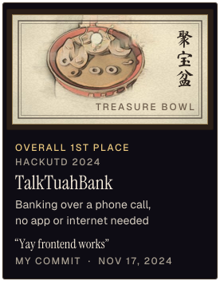
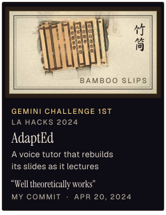
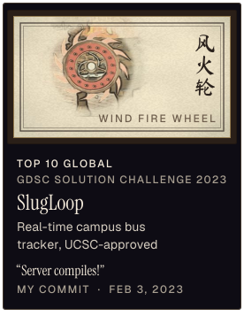
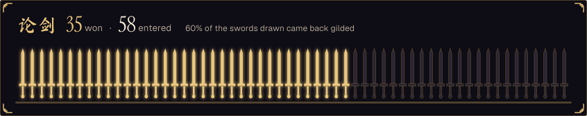
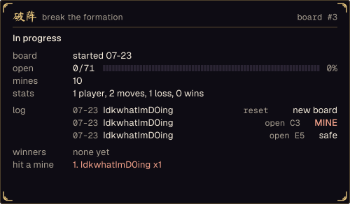
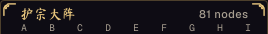

<a id="top"></a>
<!--
  hi :) you found the source.
  if you email me, put MOON GATE in the subject so I know you read this far.
-->

<!-- MAP:START -->
<p><a href="https://art3m1s.me"><picture><source media="(max-width: 600px)" srcset="assets/map/head-phone.svg"><source media="(prefers-color-scheme: light)" srcset="assets/map/head-light.svg"></picture></a><br>
<a href="#user-content-contact"><picture><source media="(max-width: 600px)" srcset="assets/map/summit-phone.svg"><source media="(prefers-color-scheme: light)" srcset="assets/map/summit-light.svg"></picture></a><br>
<a href="#user-content-now"><picture><source media="(max-width: 600px)" srcset="assets/map/abode-phone.svg"><source media="(prefers-color-scheme: light)" srcset="assets/map/abode-light.svg"></picture></a><br>
<a href="#user-content-play"><picture><source media="(max-width: 600px)" srcset="assets/map/formation-phone.svg"><source media="(prefers-color-scheme: light)" srcset="assets/map/formation-light.svg"></picture></a><br>
<a href="https://art3m1s.me/resume.pdf"><picture><source media="(max-width: 600px)" srcset="assets/map/scroll-phone.svg"><source media="(prefers-color-scheme: light)" srcset="assets/map/scroll-light.svg"></picture></a><br>
<a href="#user-content-tools"><picture><source media="(max-width: 600px)" srcset="assets/map/steles-phone.svg"><source media="(prefers-color-scheme: light)" srcset="assets/map/steles-light.svg"></picture></a><br>
<a href="#user-content-school"><picture><source media="(max-width: 600px)" srcset="assets/map/library-phone.svg"><source media="(prefers-color-scheme: light)" srcset="assets/map/library-light.svg"></picture></a><br>
<a href="#user-content-work"><picture><source media="(max-width: 600px)" srcset="assets/map/mission-phone.svg"><source media="(prefers-color-scheme: light)" srcset="assets/map/mission-light.svg"></picture></a><br>
<a href="#user-content-hackathons"><picture><source media="(max-width: 600px)" srcset="assets/map/arena-phone.svg"><source media="(prefers-color-scheme: light)" srcset="assets/map/arena-light.svg"></picture></a><br>
<a href="#user-content-shipped"><picture><source media="(max-width: 600px)" srcset="assets/map/forge-phone.svg"><source media="(prefers-color-scheme: light)" srcset="assets/map/forge-light.svg"></picture></a><br>
<a href="#user-content-about"><picture><source media="(max-width: 600px)" srcset="assets/map/mirror-phone.svg"><source media="(prefers-color-scheme: light)" srcset="assets/map/mirror-light.svg"></picture></a><br>
<a href="https://art3m1s.me"><picture><source media="(max-width: 600px) and (prefers-reduced-motion: reduce)" srcset="assets/map/gate-phone-still.svg"><source media="(max-width: 600px)" srcset="assets/map/gate-phone.svg"><source media="(prefers-reduced-motion: reduce) and (prefers-color-scheme: light)" srcset="assets/map/gate-light-still.svg"><source media="(prefers-color-scheme: light)" srcset="assets/map/gate-light.svg"><source media="(prefers-reduced-motion: reduce)" srcset="assets/map/gate-still.svg"></picture></a><br>
<picture><source media="(max-width: 600px)" srcset="assets/map/foot-phone.svg"><source media="(prefers-color-scheme: light)" srcset="assets/map/foot-light.svg"></picture></p>
<!-- MAP:END -->

<a id="about"></a>
<p>I build voice-first LLM agents at Pinterest, and I've won 36 of the 59 hackathons I've entered. Before that I shipped a multi-agent claims system at Scale AI that handled up to 20K claims a week.</p>

<a id="shipped"></a>
<p><picture><source media="(max-width: 600px)" srcset="assets/banners/shipped-phone.svg"><source media="(prefers-color-scheme: light)" srcset="assets/banners/shipped-light.svg"></picture></p>

<!-- HACKLOG:START -->
<p><a href="https://github.com/IdkwhatImD0ing/DispatchAI"><picture><source media="(max-width: 600px)" srcset="assets/journal/dispatchai-spread-phone.svg"><source media="(prefers-color-scheme: light)" srcset="assets/journal/dispatchai-spread-light.svg"></picture></a><br>
<a href="https://github.com/aurelisajuan/TalkTuahBank"><picture><source media="(max-width: 600px)" srcset="assets/journal/talktuahbank.svg"><source media="(prefers-color-scheme: light)" srcset="assets/journal/talktuahbank-light.svg"></picture></a><a href="https://github.com/IdkwhatImD0ing/AdaptEd"><picture><source media="(max-width: 600px)" srcset="assets/journal/adapted.svg"><source media="(prefers-color-scheme: light)" srcset="assets/journal/adapted-light.svg"></picture></a><a href="https://github.com/SlugLoop/SlugLoop"><picture><source media="(max-width: 600px)" srcset="assets/journal/slugloop.svg"><source media="(prefers-color-scheme: light)" srcset="assets/journal/slugloop-light.svg"></picture></a></p>
<!-- HACKLOG:END -->

<a id="hackathons"></a>
<p><picture><source media="(max-width: 600px)" srcset="assets/arena/record-phone.svg"><source media="(prefers-color-scheme: light)" srcset="assets/arena/record-light.svg"></picture></p>

<p>Most of the wins were in college. I still enter a few a year, and I judged LA Hacks 2026. What I learned is in <a href="https://thehackathonplaybook.dev">The Hackathon Playbook</a> and on <a href="https://www.youtube.com/@hackable-projects">YouTube</a>, and all the builds are on <a href="https://devpost.com/IdkwhatImD0ing">Devpost</a>.</p>

<a id="work"></a>
<p><picture><source media="(max-width: 600px)" srcset="assets/banners/work-phone.svg"><source media="(prefers-color-scheme: light)" srcset="assets/banners/work-light.svg"></picture></p>

<p><b>Pinterest</b>, Software Engineer II, 2026–now. Building LLM agents for internal and partner workflows.<br>
<b>Scale AI</b>, Applied AI Engineer, 2025–2026. Multi-agent claims system, up to 20K claims a week.<br>
<b>RingCentral</b>, AI Engineer, 2023–2025. LLM evals for 10,000+ weekly support chats, 8 hours cut to 1.<br>
<b>Dispatch AI</b>, Co-founder, 2024. Voice agent for 911 dispatch. Got $50K from Berkeley SkyDeck and AIC.<br>
<b>SlugLoop</b>, Founder, 2023–2024. UCSC's real-time bus tracker, 20,000+ users.<br>
<b>X-Camp</b>, Instructor, 2022–2023. Taught Python and coached USACO students.</p>

<a id="school"></a>
<p><b>USC</b>, M.S. Computer Science, AI specialization, 2023–2025.<br>
<b>UC Santa Cruz</b>, B.S. Computer Science in 2.5 years, 2020–2023.</p>

<a id="tools"></a>
<p>I work in TypeScript and Python, with React, Next.js, FastAPI and Postgres, and Retell, ElevenLabs, Hume and Twilio for voice.</p>

<a id="now"></a>
<p><picture><source media="(max-width: 600px)" srcset="assets/banners/now-phone.svg"><source media="(prefers-color-scheme: light)" srcset="assets/banners/now-light.svg"></picture></p>

<!-- NOW:START -->
<p><b><a href="https://github.com/IdkwhatImD0ing/PortfolioV5">PortfolioV5</a></b> · Oct 24 · Grew the forest canopy around the pillars in the sect scene.<br>
<b><a href="https://github.com/IdkwhatImD0ing/hackathonstarterkit">hackathonstarterkit</a></b> · Oct 14 · Replace homepage MCP prompt with agent install dropdown.<br>
<b><a href="https://github.com/IdkwhatImD0ing/claude-music-videos">claude-music-videos</a></b> · Oct 4 · Link the video on YouTube.</p>
<!-- NOW:END -->

<p><sub>An LLM writes these from my public commits, twice a week. <a href=".github/workflows/profile-summary.yaml">How it works</a></sub></p>
<!-- BUILD_PLATE:START -->
<!-- steward run 0, from local -->
<!-- BUILD_PLATE:END -->

<p>&nbsp;</p>

<a id="record"></a>
<details name="menu">
<summary>Full record: the 36 hackathons I've won</summary>

<p><b>2025</b><br>
SentinelAI · HackDavis · Best AI/ML Hack<br>
Vocalyze · HackMerced · Letta AI + Finance<br>
Team Food Tactics · SpartaHacks · Sustainability<br>
SlugMeditate · CruzHacks · Niantic WebXR</p>

<p><b>2024</b><br>
DispatchAI · UC Berkeley AI Hackathon · Grand Prize<br>
TalkTuahBank · HackUTD · Overall 1st Place<br>
linguify · VTHacks · Best Startup Hack<br>
Tidbits · YaleHacks · 1st Place<br>
AdaptEd · LA Hacks · Gemini Challenge 1st<br>
SoundSearch · AIATL · NLX Overall<br>
SplatNFT · SoCalTechWeek · Solana University<br>
PyPointer · HackMerced · Letta + Finance<br>
ABSeas · DiamondHacks · Captain's Classroom<br>
XPlore · IrvineHacks · Best Travel Hack<br>
SwarmAID · HackDearborn · 2nd Place<br>
Mad Lyrics · Uncommon Hacks · Programmatic Art<br>
Doggo AI · HackDavis · Best Intel Dev Cloud<br>
Talking Terry · QWER Hacks · Best Google Cloud<br>
Tank · FullyHacks · 1st Place</p>

<p><b>2023</b><br>
WebWeaver · AIATL · Most Innovative Startup<br>
SlugLoop · CruzHacks · MLH GitHub<br>
GitPT · SBHacks · Student Life Hack<br>
IntelliConverse · HackDavis · Best MongoDB Atlas<br>
MonkeySign · CitrusHacks · New Frontiers<br>
Assistance · ACMHacks · Best Global Solution<br>
PaddyPlantPrognosis · Hackrithmitic · Best Data Science<br>
Architect · Hacks for Hackers · 3rd Overall<br>
Fundraiser · Web3Apps · Microsoft Cloud + Circle<br>
Sink or Swim · Planet Unity · Top 10</p>

<p><b>2022</b><br>
Covinet · CruzHacks · QB3 @ UCSC<br>
Progno D · AI Hacks · 1st Overall<br>
Wonder · WildHacks · 2nd Overall<br>
Volunteer Hub · Opportunity Hacks · 3rd Place<br>
Pool Party · GraceHacks · Best Mobile<br>
Remote Trainer · PeddieHacks · Innovation Prize (HS)<br>
Tetris Duels · Funathon · Participation Prize</p>

</details>

<a id="play"></a><a id="fsck"></a>
<details name="menu">
<summary>Play: Minesweeper, but you play it by opening issues</summary>

<p>Click a square, then submit the issue it opens. The board updates in about a minute.</p>

<!-- FSCK:START -->
<p>
<picture><source media="(max-width: 600px)" srcset="assets/formation/panel-0-phone.svg"><source media="(prefers-color-scheme: light)" srcset="assets/formation/panel-0-light.svg"></picture><picture><source media="(max-width: 600px)" srcset="assets/formation/tiles/dark/cols.svg"><source media="(prefers-color-scheme: light)" srcset="assets/formation/tiles/light/cols.svg"></picture><br>
<picture><source media="(max-width: 600px)" srcset="assets/formation/tiles/dark/r1.svg"><source media="(prefers-color-scheme: light)" srcset="assets/formation/tiles/light/r1.svg"></picture><a href="https://github.com/IdkwhatImD0ing/IdkwhatImD0ing/issues/new?title=sect%7Czhen%7CA1&amp;body=Submit+this+issue+to+open+A1.+The+board+on+my+profile+updates+in+about+a+minute."><picture><source media="(max-width: 600px)" srcset="assets/formation/tiles/dark/hidden.svg"><source media="(prefers-color-scheme: light)" srcset="assets/formation/tiles/light/hidden.svg"></picture></a><a href="https://github.com/IdkwhatImD0ing/IdkwhatImD0ing/issues/new?title=sect%7Czhen%7CB1&amp;body=Submit+this+issue+to+open+B1.+The+board+on+my+profile+updates+in+about+a+minute."><picture><source media="(max-width: 600px)" srcset="assets/formation/tiles/dark/hidden.svg"><source media="(prefers-color-scheme: light)" srcset="assets/formation/tiles/light/hidden.svg"></picture></a><a href="https://github.com/IdkwhatImD0ing/IdkwhatImD0ing/issues/new?title=sect%7Czhen%7CC1&amp;body=Submit+this+issue+to+open+C1.+The+board+on+my+profile+updates+in+about+a+minute."><picture><source media="(max-width: 600px)" srcset="assets/formation/tiles/dark/hidden.svg"><source media="(prefers-color-scheme: light)" srcset="assets/formation/tiles/light/hidden.svg"></picture></a><a href="https://github.com/IdkwhatImD0ing/IdkwhatImD0ing/issues/new?title=sect%7Czhen%7CD1&amp;body=Submit+this+issue+to+open+D1.+The+board+on+my+profile+updates+in+about+a+minute."><picture><source media="(max-width: 600px)" srcset="assets/formation/tiles/dark/hidden.svg"><source media="(prefers-color-scheme: light)" srcset="assets/formation/tiles/light/hidden.svg"></picture></a><a href="https://github.com/IdkwhatImD0ing/IdkwhatImD0ing/issues/new?title=sect%7Czhen%7CE1&amp;body=Submit+this+issue+to+open+E1.+The+board+on+my+profile+updates+in+about+a+minute."><picture><source media="(max-width: 600px)" srcset="assets/formation/tiles/dark/hidden.svg"><source media="(prefers-color-scheme: light)" srcset="assets/formation/tiles/light/hidden.svg"></picture></a><a href="https://github.com/IdkwhatImD0ing/IdkwhatImD0ing/issues/new?title=sect%7Czhen%7CF1&amp;body=Submit+this+issue+to+open+F1.+The+board+on+my+profile+updates+in+about+a+minute."><picture><source media="(max-width: 600px)" srcset="assets/formation/tiles/dark/hidden.svg"><source media="(prefers-color-scheme: light)" srcset="assets/formation/tiles/light/hidden.svg"></picture></a><a href="https://github.com/IdkwhatImD0ing/IdkwhatImD0ing/issues/new?title=sect%7Czhen%7CG1&amp;body=Submit+this+issue+to+open+G1.+The+board+on+my+profile+updates+in+about+a+minute."><picture><source media="(max-width: 600px)" srcset="assets/formation/tiles/dark/hidden.svg"><source media="(prefers-color-scheme: light)" srcset="assets/formation/tiles/light/hidden.svg"></picture></a><a href="https://github.com/IdkwhatImD0ing/IdkwhatImD0ing/issues/new?title=sect%7Czhen%7CH1&amp;body=Submit+this+issue+to+open+H1.+The+board+on+my+profile+updates+in+about+a+minute."><picture><source media="(max-width: 600px)" srcset="assets/formation/tiles/dark/hidden.svg"><source media="(prefers-color-scheme: light)" srcset="assets/formation/tiles/light/hidden.svg"></picture></a><a href="https://github.com/IdkwhatImD0ing/IdkwhatImD0ing/issues/new?title=sect%7Czhen%7CI1&amp;body=Submit+this+issue+to+open+I1.+The+board+on+my+profile+updates+in+about+a+minute."><picture><source media="(max-width: 600px)" srcset="assets/formation/tiles/dark/hidden.svg"><source media="(prefers-color-scheme: light)" srcset="assets/formation/tiles/light/hidden.svg"></picture></a><picture><source media="(max-width: 600px)" srcset="assets/formation/tiles/dark/edge.svg"><source media="(prefers-color-scheme: light)" srcset="assets/formation/tiles/light/edge.svg"></picture><br>
<picture><source media="(max-width: 600px)" srcset="assets/formation/tiles/dark/r2.svg"><source media="(prefers-color-scheme: light)" srcset="assets/formation/tiles/light/r2.svg"></picture><a href="https://github.com/IdkwhatImD0ing/IdkwhatImD0ing/issues/new?title=sect%7Czhen%7CA2&amp;body=Submit+this+issue+to+open+A2.+The+board+on+my+profile+updates+in+about+a+minute."><picture><source media="(max-width: 600px)" srcset="assets/formation/tiles/dark/hidden.svg"><source media="(prefers-color-scheme: light)" srcset="assets/formation/tiles/light/hidden.svg"></picture></a><a href="https://github.com/IdkwhatImD0ing/IdkwhatImD0ing/issues/new?title=sect%7Czhen%7CB2&amp;body=Submit+this+issue+to+open+B2.+The+board+on+my+profile+updates+in+about+a+minute."><picture><source media="(max-width: 600px)" srcset="assets/formation/tiles/dark/hidden.svg"><source media="(prefers-color-scheme: light)" srcset="assets/formation/tiles/light/hidden.svg"></picture></a><a href="https://github.com/IdkwhatImD0ing/IdkwhatImD0ing/issues/new?title=sect%7Czhen%7CC2&amp;body=Submit+this+issue+to+open+C2.+The+board+on+my+profile+updates+in+about+a+minute."><picture><source media="(max-width: 600px)" srcset="assets/formation/tiles/dark/hidden.svg"><source media="(prefers-color-scheme: light)" srcset="assets/formation/tiles/light/hidden.svg"></picture></a><a href="https://github.com/IdkwhatImD0ing/IdkwhatImD0ing/issues/new?title=sect%7Czhen%7CD2&amp;body=Submit+this+issue+to+open+D2.+The+board+on+my+profile+updates+in+about+a+minute."><picture><source media="(max-width: 600px)" srcset="assets/formation/tiles/dark/hidden.svg"><source media="(prefers-color-scheme: light)" srcset="assets/formation/tiles/light/hidden.svg"></picture></a><a href="https://github.com/IdkwhatImD0ing/IdkwhatImD0ing/issues/new?title=sect%7Czhen%7CE2&amp;body=Submit+this+issue+to+open+E2.+The+board+on+my+profile+updates+in+about+a+minute."><picture><source media="(max-width: 600px)" srcset="assets/formation/tiles/dark/hidden.svg"><source media="(prefers-color-scheme: light)" srcset="assets/formation/tiles/light/hidden.svg"></picture></a><a href="https://github.com/IdkwhatImD0ing/IdkwhatImD0ing/issues/new?title=sect%7Czhen%7CF2&amp;body=Submit+this+issue+to+open+F2.+The+board+on+my+profile+updates+in+about+a+minute."><picture><source media="(max-width: 600px)" srcset="assets/formation/tiles/dark/hidden.svg"><source media="(prefers-color-scheme: light)" srcset="assets/formation/tiles/light/hidden.svg"></picture></a><a href="https://github.com/IdkwhatImD0ing/IdkwhatImD0ing/issues/new?title=sect%7Czhen%7CG2&amp;body=Submit+this+issue+to+open+G2.+The+board+on+my+profile+updates+in+about+a+minute."><picture><source media="(max-width: 600px)" srcset="assets/formation/tiles/dark/hidden.svg"><source media="(prefers-color-scheme: light)" srcset="assets/formation/tiles/light/hidden.svg"></picture></a><a href="https://github.com/IdkwhatImD0ing/IdkwhatImD0ing/issues/new?title=sect%7Czhen%7CH2&amp;body=Submit+this+issue+to+open+H2.+The+board+on+my+profile+updates+in+about+a+minute."><picture><source media="(max-width: 600px)" srcset="assets/formation/tiles/dark/hidden.svg"><source media="(prefers-color-scheme: light)" srcset="assets/formation/tiles/light/hidden.svg"></picture></a><a href="https://github.com/IdkwhatImD0ing/IdkwhatImD0ing/issues/new?title=sect%7Czhen%7CI2&amp;body=Submit+this+issue+to+open+I2.+The+board+on+my+profile+updates+in+about+a+minute."><picture><source media="(max-width: 600px)" srcset="assets/formation/tiles/dark/hidden.svg"><source media="(prefers-color-scheme: light)" srcset="assets/formation/tiles/light/hidden.svg"></picture></a><picture><source media="(max-width: 600px)" srcset="assets/formation/tiles/dark/edge.svg"><source media="(prefers-color-scheme: light)" srcset="assets/formation/tiles/light/edge.svg"></picture><br>
<picture><source media="(max-width: 600px)" srcset="assets/formation/tiles/dark/r3.svg"><source media="(prefers-color-scheme: light)" srcset="assets/formation/tiles/light/r3.svg"></picture><a href="https://github.com/IdkwhatImD0ing/IdkwhatImD0ing/issues/new?title=sect%7Czhen%7CA3&amp;body=Submit+this+issue+to+open+A3.+The+board+on+my+profile+updates+in+about+a+minute."><picture><source media="(max-width: 600px)" srcset="assets/formation/tiles/dark/hidden.svg"><source media="(prefers-color-scheme: light)" srcset="assets/formation/tiles/light/hidden.svg"></picture></a><a href="https://github.com/IdkwhatImD0ing/IdkwhatImD0ing/issues/new?title=sect%7Czhen%7CB3&amp;body=Submit+this+issue+to+open+B3.+The+board+on+my+profile+updates+in+about+a+minute."><picture><source media="(max-width: 600px)" srcset="assets/formation/tiles/dark/hidden.svg"><source media="(prefers-color-scheme: light)" srcset="assets/formation/tiles/light/hidden.svg"></picture></a><a href="https://github.com/IdkwhatImD0ing/IdkwhatImD0ing/issues/new?title=sect%7Czhen%7CC3&amp;body=Submit+this+issue+to+open+C3.+The+board+on+my+profile+updates+in+about+a+minute."><picture><source media="(max-width: 600px)" srcset="assets/formation/tiles/dark/hidden.svg"><source media="(prefers-color-scheme: light)" srcset="assets/formation/tiles/light/hidden.svg"></picture></a><a href="https://github.com/IdkwhatImD0ing/IdkwhatImD0ing/issues/new?title=sect%7Czhen%7CD3&amp;body=Submit+this+issue+to+open+D3.+The+board+on+my+profile+updates+in+about+a+minute."><picture><source media="(max-width: 600px)" srcset="assets/formation/tiles/dark/hidden.svg"><source media="(prefers-color-scheme: light)" srcset="assets/formation/tiles/light/hidden.svg"></picture></a><a href="https://github.com/IdkwhatImD0ing/IdkwhatImD0ing/issues/new?title=sect%7Czhen%7CE3&amp;body=Submit+this+issue+to+open+E3.+The+board+on+my+profile+updates+in+about+a+minute."><picture><source media="(max-width: 600px)" srcset="assets/formation/tiles/dark/hidden.svg"><source media="(prefers-color-scheme: light)" srcset="assets/formation/tiles/light/hidden.svg"></picture></a><a href="https://github.com/IdkwhatImD0ing/IdkwhatImD0ing/issues/new?title=sect%7Czhen%7CF3&amp;body=Submit+this+issue+to+open+F3.+The+board+on+my+profile+updates+in+about+a+minute."><picture><source media="(max-width: 600px)" srcset="assets/formation/tiles/dark/hidden.svg"><source media="(prefers-color-scheme: light)" srcset="assets/formation/tiles/light/hidden.svg"></picture></a><a href="https://github.com/IdkwhatImD0ing/IdkwhatImD0ing/issues/new?title=sect%7Czhen%7CG3&amp;body=Submit+this+issue+to+open+G3.+The+board+on+my+profile+updates+in+about+a+minute."><picture><source media="(max-width: 600px)" srcset="assets/formation/tiles/dark/hidden.svg"><source media="(prefers-color-scheme: light)" srcset="assets/formation/tiles/light/hidden.svg"></picture></a><a href="https://github.com/IdkwhatImD0ing/IdkwhatImD0ing/issues/new?title=sect%7Czhen%7CH3&amp;body=Submit+this+issue+to+open+H3.+The+board+on+my+profile+updates+in+about+a+minute."><picture><source media="(max-width: 600px)" srcset="assets/formation/tiles/dark/hidden.svg"><source media="(prefers-color-scheme: light)" srcset="assets/formation/tiles/light/hidden.svg"></picture></a><a href="https://github.com/IdkwhatImD0ing/IdkwhatImD0ing/issues/new?title=sect%7Czhen%7CI3&amp;body=Submit+this+issue+to+open+I3.+The+board+on+my+profile+updates+in+about+a+minute."><picture><source media="(max-width: 600px)" srcset="assets/formation/tiles/dark/hidden.svg"><source media="(prefers-color-scheme: light)" srcset="assets/formation/tiles/light/hidden.svg"></picture></a><picture><source media="(max-width: 600px)" srcset="assets/formation/tiles/dark/edge.svg"><source media="(prefers-color-scheme: light)" srcset="assets/formation/tiles/light/edge.svg"></picture><br>
<picture><source media="(max-width: 600px)" srcset="assets/formation/tiles/dark/r4.svg"><source media="(prefers-color-scheme: light)" srcset="assets/formation/tiles/light/r4.svg"></picture><a href="https://github.com/IdkwhatImD0ing/IdkwhatImD0ing/issues/new?title=sect%7Czhen%7CA4&amp;body=Submit+this+issue+to+open+A4.+The+board+on+my+profile+updates+in+about+a+minute."><picture><source media="(max-width: 600px)" srcset="assets/formation/tiles/dark/hidden.svg"><source media="(prefers-color-scheme: light)" srcset="assets/formation/tiles/light/hidden.svg"></picture></a><a href="https://github.com/IdkwhatImD0ing/IdkwhatImD0ing/issues/new?title=sect%7Czhen%7CB4&amp;body=Submit+this+issue+to+open+B4.+The+board+on+my+profile+updates+in+about+a+minute."><picture><source media="(max-width: 600px)" srcset="assets/formation/tiles/dark/hidden.svg"><source media="(prefers-color-scheme: light)" srcset="assets/formation/tiles/light/hidden.svg"></picture></a><a href="https://github.com/IdkwhatImD0ing/IdkwhatImD0ing/issues/new?title=sect%7Czhen%7CC4&amp;body=Submit+this+issue+to+open+C4.+The+board+on+my+profile+updates+in+about+a+minute."><picture><source media="(max-width: 600px)" srcset="assets/formation/tiles/dark/hidden.svg"><source media="(prefers-color-scheme: light)" srcset="assets/formation/tiles/light/hidden.svg"></picture></a><a href="https://github.com/IdkwhatImD0ing/IdkwhatImD0ing/issues/new?title=sect%7Czhen%7CD4&amp;body=Submit+this+issue+to+open+D4.+The+board+on+my+profile+updates+in+about+a+minute."><picture><source media="(max-width: 600px)" srcset="assets/formation/tiles/dark/hidden.svg"><source media="(prefers-color-scheme: light)" srcset="assets/formation/tiles/light/hidden.svg"></picture></a><a href="https://github.com/IdkwhatImD0ing/IdkwhatImD0ing/issues/new?title=sect%7Czhen%7CE4&amp;body=Submit+this+issue+to+open+E4.+The+board+on+my+profile+updates+in+about+a+minute."><picture><source media="(max-width: 600px)" srcset="assets/formation/tiles/dark/hidden.svg"><source media="(prefers-color-scheme: light)" srcset="assets/formation/tiles/light/hidden.svg"></picture></a><a href="https://github.com/IdkwhatImD0ing/IdkwhatImD0ing/issues/new?title=sect%7Czhen%7CF4&amp;body=Submit+this+issue+to+open+F4.+The+board+on+my+profile+updates+in+about+a+minute."><picture><source media="(max-width: 600px)" srcset="assets/formation/tiles/dark/hidden.svg"><source media="(prefers-color-scheme: light)" srcset="assets/formation/tiles/light/hidden.svg"></picture></a><a href="https://github.com/IdkwhatImD0ing/IdkwhatImD0ing/issues/new?title=sect%7Czhen%7CG4&amp;body=Submit+this+issue+to+open+G4.+The+board+on+my+profile+updates+in+about+a+minute."><picture><source media="(max-width: 600px)" srcset="assets/formation/tiles/dark/hidden.svg"><source media="(prefers-color-scheme: light)" srcset="assets/formation/tiles/light/hidden.svg"></picture></a><a href="https://github.com/IdkwhatImD0ing/IdkwhatImD0ing/issues/new?title=sect%7Czhen%7CH4&amp;body=Submit+this+issue+to+open+H4.+The+board+on+my+profile+updates+in+about+a+minute."><picture><source media="(max-width: 600px)" srcset="assets/formation/tiles/dark/hidden.svg"><source media="(prefers-color-scheme: light)" srcset="assets/formation/tiles/light/hidden.svg"></picture></a><a href="https://github.com/IdkwhatImD0ing/IdkwhatImD0ing/issues/new?title=sect%7Czhen%7CI4&amp;body=Submit+this+issue+to+open+I4.+The+board+on+my+profile+updates+in+about+a+minute."><picture><source media="(max-width: 600px)" srcset="assets/formation/tiles/dark/hidden.svg"><source media="(prefers-color-scheme: light)" srcset="assets/formation/tiles/light/hidden.svg"></picture></a><picture><source media="(max-width: 600px)" srcset="assets/formation/tiles/dark/edge.svg"><source media="(prefers-color-scheme: light)" srcset="assets/formation/tiles/light/edge.svg"></picture><br>
<picture><source media="(max-width: 600px)" srcset="assets/formation/tiles/dark/r5.svg"><source media="(prefers-color-scheme: light)" srcset="assets/formation/tiles/light/r5.svg"></picture><a href="https://github.com/IdkwhatImD0ing/IdkwhatImD0ing/issues/new?title=sect%7Czhen%7CA5&amp;body=Submit+this+issue+to+open+A5.+The+board+on+my+profile+updates+in+about+a+minute."><picture><source media="(max-width: 600px)" srcset="assets/formation/tiles/dark/hidden.svg"><source media="(prefers-color-scheme: light)" srcset="assets/formation/tiles/light/hidden.svg"></picture></a><a href="https://github.com/IdkwhatImD0ing/IdkwhatImD0ing/issues/new?title=sect%7Czhen%7CB5&amp;body=Submit+this+issue+to+open+B5.+The+board+on+my+profile+updates+in+about+a+minute."><picture><source media="(max-width: 600px)" srcset="assets/formation/tiles/dark/hidden.svg"><source media="(prefers-color-scheme: light)" srcset="assets/formation/tiles/light/hidden.svg"></picture></a><a href="https://github.com/IdkwhatImD0ing/IdkwhatImD0ing/issues/new?title=sect%7Czhen%7CC5&amp;body=Submit+this+issue+to+open+C5.+The+board+on+my+profile+updates+in+about+a+minute."><picture><source media="(max-width: 600px)" srcset="assets/formation/tiles/dark/hidden.svg"><source media="(prefers-color-scheme: light)" srcset="assets/formation/tiles/light/hidden.svg"></picture></a><a href="https://github.com/IdkwhatImD0ing/IdkwhatImD0ing/issues/new?title=sect%7Czhen%7CD5&amp;body=Submit+this+issue+to+open+D5.+The+board+on+my+profile+updates+in+about+a+minute."><picture><source media="(max-width: 600px)" srcset="assets/formation/tiles/dark/hidden.svg"><source media="(prefers-color-scheme: light)" srcset="assets/formation/tiles/light/hidden.svg"></picture></a><a href="https://github.com/IdkwhatImD0ing/IdkwhatImD0ing/issues/new?title=sect%7Czhen%7CE5&amp;body=Submit+this+issue+to+open+E5.+The+board+on+my+profile+updates+in+about+a+minute."><picture><source media="(max-width: 600px)" srcset="assets/formation/tiles/dark/hidden.svg"><source media="(prefers-color-scheme: light)" srcset="assets/formation/tiles/light/hidden.svg"></picture></a><a href="https://github.com/IdkwhatImD0ing/IdkwhatImD0ing/issues/new?title=sect%7Czhen%7CF5&amp;body=Submit+this+issue+to+open+F5.+The+board+on+my+profile+updates+in+about+a+minute."><picture><source media="(max-width: 600px)" srcset="assets/formation/tiles/dark/hidden.svg"><source media="(prefers-color-scheme: light)" srcset="assets/formation/tiles/light/hidden.svg"></picture></a><a href="https://github.com/IdkwhatImD0ing/IdkwhatImD0ing/issues/new?title=sect%7Czhen%7CG5&amp;body=Submit+this+issue+to+open+G5.+The+board+on+my+profile+updates+in+about+a+minute."><picture><source media="(max-width: 600px)" srcset="assets/formation/tiles/dark/hidden.svg"><source media="(prefers-color-scheme: light)" srcset="assets/formation/tiles/light/hidden.svg"></picture></a><a href="https://github.com/IdkwhatImD0ing/IdkwhatImD0ing/issues/new?title=sect%7Czhen%7CH5&amp;body=Submit+this+issue+to+open+H5.+The+board+on+my+profile+updates+in+about+a+minute."><picture><source media="(max-width: 600px)" srcset="assets/formation/tiles/dark/hidden.svg"><source media="(prefers-color-scheme: light)" srcset="assets/formation/tiles/light/hidden.svg"></picture></a><a href="https://github.com/IdkwhatImD0ing/IdkwhatImD0ing/issues/new?title=sect%7Czhen%7CI5&amp;body=Submit+this+issue+to+open+I5.+The+board+on+my+profile+updates+in+about+a+minute."><picture><source media="(max-width: 600px)" srcset="assets/formation/tiles/dark/hidden.svg"><source media="(prefers-color-scheme: light)" srcset="assets/formation/tiles/light/hidden.svg"></picture></a><picture><source media="(max-width: 600px)" srcset="assets/formation/tiles/dark/edge.svg"><source media="(prefers-color-scheme: light)" srcset="assets/formation/tiles/light/edge.svg"></picture><br>
<picture><source media="(max-width: 600px)" srcset="assets/formation/tiles/dark/r6.svg"><source media="(prefers-color-scheme: light)" srcset="assets/formation/tiles/light/r6.svg"></picture><a href="https://github.com/IdkwhatImD0ing/IdkwhatImD0ing/issues/new?title=sect%7Czhen%7CA6&amp;body=Submit+this+issue+to+open+A6.+The+board+on+my+profile+updates+in+about+a+minute."><picture><source media="(max-width: 600px)" srcset="assets/formation/tiles/dark/hidden.svg"><source media="(prefers-color-scheme: light)" srcset="assets/formation/tiles/light/hidden.svg"></picture></a><a href="https://github.com/IdkwhatImD0ing/IdkwhatImD0ing/issues/new?title=sect%7Czhen%7CB6&amp;body=Submit+this+issue+to+open+B6.+The+board+on+my+profile+updates+in+about+a+minute."><picture><source media="(max-width: 600px)" srcset="assets/formation/tiles/dark/hidden.svg"><source media="(prefers-color-scheme: light)" srcset="assets/formation/tiles/light/hidden.svg"></picture></a><a href="https://github.com/IdkwhatImD0ing/IdkwhatImD0ing/issues/new?title=sect%7Czhen%7CC6&amp;body=Submit+this+issue+to+open+C6.+The+board+on+my+profile+updates+in+about+a+minute."><picture><source media="(max-width: 600px)" srcset="assets/formation/tiles/dark/hidden.svg"><source media="(prefers-color-scheme: light)" srcset="assets/formation/tiles/light/hidden.svg"></picture></a><a href="https://github.com/IdkwhatImD0ing/IdkwhatImD0ing/issues/new?title=sect%7Czhen%7CD6&amp;body=Submit+this+issue+to+open+D6.+The+board+on+my+profile+updates+in+about+a+minute."><picture><source media="(max-width: 600px)" srcset="assets/formation/tiles/dark/hidden.svg"><source media="(prefers-color-scheme: light)" srcset="assets/formation/tiles/light/hidden.svg"></picture></a><a href="https://github.com/IdkwhatImD0ing/IdkwhatImD0ing/issues/new?title=sect%7Czhen%7CE6&amp;body=Submit+this+issue+to+open+E6.+The+board+on+my+profile+updates+in+about+a+minute."><picture><source media="(max-width: 600px)" srcset="assets/formation/tiles/dark/hidden.svg"><source media="(prefers-color-scheme: light)" srcset="assets/formation/tiles/light/hidden.svg"></picture></a><a href="https://github.com/IdkwhatImD0ing/IdkwhatImD0ing/issues/new?title=sect%7Czhen%7CF6&amp;body=Submit+this+issue+to+open+F6.+The+board+on+my+profile+updates+in+about+a+minute."><picture><source media="(max-width: 600px)" srcset="assets/formation/tiles/dark/hidden.svg"><source media="(prefers-color-scheme: light)" srcset="assets/formation/tiles/light/hidden.svg"></picture></a><a href="https://github.com/IdkwhatImD0ing/IdkwhatImD0ing/issues/new?title=sect%7Czhen%7CG6&amp;body=Submit+this+issue+to+open+G6.+The+board+on+my+profile+updates+in+about+a+minute."><picture><source media="(max-width: 600px)" srcset="assets/formation/tiles/dark/hidden.svg"><source media="(prefers-color-scheme: light)" srcset="assets/formation/tiles/light/hidden.svg"></picture></a><a href="https://github.com/IdkwhatImD0ing/IdkwhatImD0ing/issues/new?title=sect%7Czhen%7CH6&amp;body=Submit+this+issue+to+open+H6.+The+board+on+my+profile+updates+in+about+a+minute."><picture><source media="(max-width: 600px)" srcset="assets/formation/tiles/dark/hidden.svg"><source media="(prefers-color-scheme: light)" srcset="assets/formation/tiles/light/hidden.svg"></picture></a><a href="https://github.com/IdkwhatImD0ing/IdkwhatImD0ing/issues/new?title=sect%7Czhen%7CI6&amp;body=Submit+this+issue+to+open+I6.+The+board+on+my+profile+updates+in+about+a+minute."><picture><source media="(max-width: 600px)" srcset="assets/formation/tiles/dark/hidden.svg"><source media="(prefers-color-scheme: light)" srcset="assets/formation/tiles/light/hidden.svg"></picture></a><picture><source media="(max-width: 600px)" srcset="assets/formation/tiles/dark/edge.svg"><source media="(prefers-color-scheme: light)" srcset="assets/formation/tiles/light/edge.svg"></picture><br>
<picture><source media="(max-width: 600px)" srcset="assets/formation/tiles/dark/r7.svg"><source media="(prefers-color-scheme: light)" srcset="assets/formation/tiles/light/r7.svg"></picture><a href="https://github.com/IdkwhatImD0ing/IdkwhatImD0ing/issues/new?title=sect%7Czhen%7CA7&amp;body=Submit+this+issue+to+open+A7.+The+board+on+my+profile+updates+in+about+a+minute."><picture><source media="(max-width: 600px)" srcset="assets/formation/tiles/dark/hidden.svg"><source media="(prefers-color-scheme: light)" srcset="assets/formation/tiles/light/hidden.svg"></picture></a><a href="https://github.com/IdkwhatImD0ing/IdkwhatImD0ing/issues/new?title=sect%7Czhen%7CB7&amp;body=Submit+this+issue+to+open+B7.+The+board+on+my+profile+updates+in+about+a+minute."><picture><source media="(max-width: 600px)" srcset="assets/formation/tiles/dark/hidden.svg"><source media="(prefers-color-scheme: light)" srcset="assets/formation/tiles/light/hidden.svg"></picture></a><a href="https://github.com/IdkwhatImD0ing/IdkwhatImD0ing/issues/new?title=sect%7Czhen%7CC7&amp;body=Submit+this+issue+to+open+C7.+The+board+on+my+profile+updates+in+about+a+minute."><picture><source media="(max-width: 600px)" srcset="assets/formation/tiles/dark/hidden.svg"><source media="(prefers-color-scheme: light)" srcset="assets/formation/tiles/light/hidden.svg"></picture></a><a href="https://github.com/IdkwhatImD0ing/IdkwhatImD0ing/issues/new?title=sect%7Czhen%7CD7&amp;body=Submit+this+issue+to+open+D7.+The+board+on+my+profile+updates+in+about+a+minute."><picture><source media="(max-width: 600px)" srcset="assets/formation/tiles/dark/hidden.svg"><source media="(prefers-color-scheme: light)" srcset="assets/formation/tiles/light/hidden.svg"></picture></a><a href="https://github.com/IdkwhatImD0ing/IdkwhatImD0ing/issues/new?title=sect%7Czhen%7CE7&amp;body=Submit+this+issue+to+open+E7.+The+board+on+my+profile+updates+in+about+a+minute."><picture><source media="(max-width: 600px)" srcset="assets/formation/tiles/dark/hidden.svg"><source media="(prefers-color-scheme: light)" srcset="assets/formation/tiles/light/hidden.svg"></picture></a><a href="https://github.com/IdkwhatImD0ing/IdkwhatImD0ing/issues/new?title=sect%7Czhen%7CF7&amp;body=Submit+this+issue+to+open+F7.+The+board+on+my+profile+updates+in+about+a+minute."><picture><source media="(max-width: 600px)" srcset="assets/formation/tiles/dark/hidden.svg"><source media="(prefers-color-scheme: light)" srcset="assets/formation/tiles/light/hidden.svg"></picture></a><a href="https://github.com/IdkwhatImD0ing/IdkwhatImD0ing/issues/new?title=sect%7Czhen%7CG7&amp;body=Submit+this+issue+to+open+G7.+The+board+on+my+profile+updates+in+about+a+minute."><picture><source media="(max-width: 600px)" srcset="assets/formation/tiles/dark/hidden.svg"><source media="(prefers-color-scheme: light)" srcset="assets/formation/tiles/light/hidden.svg"></picture></a><a href="https://github.com/IdkwhatImD0ing/IdkwhatImD0ing/issues/new?title=sect%7Czhen%7CH7&amp;body=Submit+this+issue+to+open+H7.+The+board+on+my+profile+updates+in+about+a+minute."><picture><source media="(max-width: 600px)" srcset="assets/formation/tiles/dark/hidden.svg"><source media="(prefers-color-scheme: light)" srcset="assets/formation/tiles/light/hidden.svg"></picture></a><a href="https://github.com/IdkwhatImD0ing/IdkwhatImD0ing/issues/new?title=sect%7Czhen%7CI7&amp;body=Submit+this+issue+to+open+I7.+The+board+on+my+profile+updates+in+about+a+minute."><picture><source media="(max-width: 600px)" srcset="assets/formation/tiles/dark/hidden.svg"><source media="(prefers-color-scheme: light)" srcset="assets/formation/tiles/light/hidden.svg"></picture></a><picture><source media="(max-width: 600px)" srcset="assets/formation/tiles/dark/edge.svg"><source media="(prefers-color-scheme: light)" srcset="assets/formation/tiles/light/edge.svg"></picture><br>
<picture><source media="(max-width: 600px)" srcset="assets/formation/tiles/dark/r8.svg"><source media="(prefers-color-scheme: light)" srcset="assets/formation/tiles/light/r8.svg"></picture><a href="https://github.com/IdkwhatImD0ing/IdkwhatImD0ing/issues/new?title=sect%7Czhen%7CA8&amp;body=Submit+this+issue+to+open+A8.+The+board+on+my+profile+updates+in+about+a+minute."><picture><source media="(max-width: 600px)" srcset="assets/formation/tiles/dark/hidden.svg"><source media="(prefers-color-scheme: light)" srcset="assets/formation/tiles/light/hidden.svg"></picture></a><a href="https://github.com/IdkwhatImD0ing/IdkwhatImD0ing/issues/new?title=sect%7Czhen%7CB8&amp;body=Submit+this+issue+to+open+B8.+The+board+on+my+profile+updates+in+about+a+minute."><picture><source media="(max-width: 600px)" srcset="assets/formation/tiles/dark/hidden.svg"><source media="(prefers-color-scheme: light)" srcset="assets/formation/tiles/light/hidden.svg"></picture></a><a href="https://github.com/IdkwhatImD0ing/IdkwhatImD0ing/issues/new?title=sect%7Czhen%7CC8&amp;body=Submit+this+issue+to+open+C8.+The+board+on+my+profile+updates+in+about+a+minute."><picture><source media="(max-width: 600px)" srcset="assets/formation/tiles/dark/hidden.svg"><source media="(prefers-color-scheme: light)" srcset="assets/formation/tiles/light/hidden.svg"></picture></a><a href="https://github.com/IdkwhatImD0ing/IdkwhatImD0ing/issues/new?title=sect%7Czhen%7CD8&amp;body=Submit+this+issue+to+open+D8.+The+board+on+my+profile+updates+in+about+a+minute."><picture><source media="(max-width: 600px)" srcset="assets/formation/tiles/dark/hidden.svg"><source media="(prefers-color-scheme: light)" srcset="assets/formation/tiles/light/hidden.svg"></picture></a><a href="https://github.com/IdkwhatImD0ing/IdkwhatImD0ing/issues/new?title=sect%7Czhen%7CE8&amp;body=Submit+this+issue+to+open+E8.+The+board+on+my+profile+updates+in+about+a+minute."><picture><source media="(max-width: 600px)" srcset="assets/formation/tiles/dark/hidden.svg"><source media="(prefers-color-scheme: light)" srcset="assets/formation/tiles/light/hidden.svg"></picture></a><a href="https://github.com/IdkwhatImD0ing/IdkwhatImD0ing/issues/new?title=sect%7Czhen%7CF8&amp;body=Submit+this+issue+to+open+F8.+The+board+on+my+profile+updates+in+about+a+minute."><picture><source media="(max-width: 600px)" srcset="assets/formation/tiles/dark/hidden.svg"><source media="(prefers-color-scheme: light)" srcset="assets/formation/tiles/light/hidden.svg"></picture></a><a href="https://github.com/IdkwhatImD0ing/IdkwhatImD0ing/issues/new?title=sect%7Czhen%7CG8&amp;body=Submit+this+issue+to+open+G8.+The+board+on+my+profile+updates+in+about+a+minute."><picture><source media="(max-width: 600px)" srcset="assets/formation/tiles/dark/hidden.svg"><source media="(prefers-color-scheme: light)" srcset="assets/formation/tiles/light/hidden.svg"></picture></a><a href="https://github.com/IdkwhatImD0ing/IdkwhatImD0ing/issues/new?title=sect%7Czhen%7CH8&amp;body=Submit+this+issue+to+open+H8.+The+board+on+my+profile+updates+in+about+a+minute."><picture><source media="(max-width: 600px)" srcset="assets/formation/tiles/dark/hidden.svg"><source media="(prefers-color-scheme: light)" srcset="assets/formation/tiles/light/hidden.svg"></picture></a><a href="https://github.com/IdkwhatImD0ing/IdkwhatImD0ing/issues/new?title=sect%7Czhen%7CI8&amp;body=Submit+this+issue+to+open+I8.+The+board+on+my+profile+updates+in+about+a+minute."><picture><source media="(max-width: 600px)" srcset="assets/formation/tiles/dark/hidden.svg"><source media="(prefers-color-scheme: light)" srcset="assets/formation/tiles/light/hidden.svg"></picture></a><picture><source media="(max-width: 600px)" srcset="assets/formation/tiles/dark/edge.svg"><source media="(prefers-color-scheme: light)" srcset="assets/formation/tiles/light/edge.svg"></picture><br>
<picture><source media="(max-width: 600px)" srcset="assets/formation/tiles/dark/r9.svg"><source media="(prefers-color-scheme: light)" srcset="assets/formation/tiles/light/r9.svg"></picture><a href="https://github.com/IdkwhatImD0ing/IdkwhatImD0ing/issues/new?title=sect%7Czhen%7CA9&amp;body=Submit+this+issue+to+open+A9.+The+board+on+my+profile+updates+in+about+a+minute."><picture><source media="(max-width: 600px)" srcset="assets/formation/tiles/dark/hidden.svg"><source media="(prefers-color-scheme: light)" srcset="assets/formation/tiles/light/hidden.svg"></picture></a><a href="https://github.com/IdkwhatImD0ing/IdkwhatImD0ing/issues/new?title=sect%7Czhen%7CB9&amp;body=Submit+this+issue+to+open+B9.+The+board+on+my+profile+updates+in+about+a+minute."><picture><source media="(max-width: 600px)" srcset="assets/formation/tiles/dark/hidden.svg"><source media="(prefers-color-scheme: light)" srcset="assets/formation/tiles/light/hidden.svg"></picture></a><a href="https://github.com/IdkwhatImD0ing/IdkwhatImD0ing/issues/new?title=sect%7Czhen%7CC9&amp;body=Submit+this+issue+to+open+C9.+The+board+on+my+profile+updates+in+about+a+minute."><picture><source media="(max-width: 600px)" srcset="assets/formation/tiles/dark/hidden.svg"><source media="(prefers-color-scheme: light)" srcset="assets/formation/tiles/light/hidden.svg"></picture></a><a href="https://github.com/IdkwhatImD0ing/IdkwhatImD0ing/issues/new?title=sect%7Czhen%7CD9&amp;body=Submit+this+issue+to+open+D9.+The+board+on+my+profile+updates+in+about+a+minute."><picture><source media="(max-width: 600px)" srcset="assets/formation/tiles/dark/hidden.svg"><source media="(prefers-color-scheme: light)" srcset="assets/formation/tiles/light/hidden.svg"></picture></a><a href="https://github.com/IdkwhatImD0ing/IdkwhatImD0ing/issues/new?title=sect%7Czhen%7CE9&amp;body=Submit+this+issue+to+open+E9.+The+board+on+my+profile+updates+in+about+a+minute."><picture><source media="(max-width: 600px)" srcset="assets/formation/tiles/dark/hidden.svg"><source media="(prefers-color-scheme: light)" srcset="assets/formation/tiles/light/hidden.svg"></picture></a><a href="https://github.com/IdkwhatImD0ing/IdkwhatImD0ing/issues/new?title=sect%7Czhen%7CF9&amp;body=Submit+this+issue+to+open+F9.+The+board+on+my+profile+updates+in+about+a+minute."><picture><source media="(max-width: 600px)" srcset="assets/formation/tiles/dark/hidden.svg"><source media="(prefers-color-scheme: light)" srcset="assets/formation/tiles/light/hidden.svg"></picture></a><a href="https://github.com/IdkwhatImD0ing/IdkwhatImD0ing/issues/new?title=sect%7Czhen%7CG9&amp;body=Submit+this+issue+to+open+G9.+The+board+on+my+profile+updates+in+about+a+minute."><picture><source media="(max-width: 600px)" srcset="assets/formation/tiles/dark/hidden.svg"><source media="(prefers-color-scheme: light)" srcset="assets/formation/tiles/light/hidden.svg"></picture></a><a href="https://github.com/IdkwhatImD0ing/IdkwhatImD0ing/issues/new?title=sect%7Czhen%7CH9&amp;body=Submit+this+issue+to+open+H9.+The+board+on+my+profile+updates+in+about+a+minute."><picture><source media="(max-width: 600px)" srcset="assets/formation/tiles/dark/hidden.svg"><source media="(prefers-color-scheme: light)" srcset="assets/formation/tiles/light/hidden.svg"></picture></a><a href="https://github.com/IdkwhatImD0ing/IdkwhatImD0ing/issues/new?title=sect%7Czhen%7CI9&amp;body=Submit+this+issue+to+open+I9.+The+board+on+my+profile+updates+in+about+a+minute."><picture><source media="(max-width: 600px)" srcset="assets/formation/tiles/dark/hidden.svg"><source media="(prefers-color-scheme: light)" srcset="assets/formation/tiles/light/hidden.svg"></picture></a><picture><source media="(max-width: 600px)" srcset="assets/formation/tiles/dark/edge.svg"><source media="(prefers-color-scheme: light)" srcset="assets/formation/tiles/light/edge.svg"></picture><br>
<picture><source media="(max-width: 600px)" srcset="assets/formation/tiles/dark/base.svg"><source media="(prefers-color-scheme: light)" srcset="assets/formation/tiles/light/base.svg"></picture><br clear="all">
</p>

<p>
<a href="https://github.com/IdkwhatImD0ing/IdkwhatImD0ing/issues/new?title=sect%7Cgong&amp;body=%3A%29"><picture><source media="(max-width: 600px)" srcset="assets/formation/gong.svg"><source media="(prefers-color-scheme: light)" srcset="assets/formation/gong-light.svg"></picture></a>
</p>
<!-- FSCK:END -->

<pre><b>弟子名册, the people who starred this repo</b><!-- PASSWD:START -->
no.  999  bill       教主 (sect leader), on GitHub since 2021-09-21
no. 1000  <a href="https://github.com/prakhxr0">prakhxr0</a>   starred 2024-06-14
<a href="https://github.com/IdkwhatImD0ing/IdkwhatImD0ing">Star this repo</a> to get on the list as no. 1001.
<!-- PASSWD:END --></pre>

```text
# my card, in your terminal (on Windows, use curl.exe)
curl -sL https://raw.githubusercontent.com/IdkwhatImD0ing/IdkwhatImD0ing/main/bill.ansi
```

<details>
<summary>Old versions of this page, and a 3D token</summary>

<pre><a href=".plan">.plan</a>          what changed on this page, and when
<a href="archive/">archive/</a>       the older versions of this profile
heimuling.stl  黑木令 (Black Wood Token) from the novel. drag to turn it</pre>

```stl
solid heimuling
facet normal 0 0 1
  outer loop
    vertex -13 -30 6
    vertex 13 -30 6
    vertex 20 -23 6
  endloop
endfacet
facet normal 0 0 -1
  outer loop
    vertex -13 -30 0
    vertex 20 -23 0
    vertex 13 -30 0
  endloop
endfacet
facet normal 0 0 1
  outer loop
    vertex -13 -30 6
    vertex 20 -23 6
    vertex 20 23 6
  endloop
endfacet
facet normal 0 0 -1
  outer loop
    vertex -13 -30 0
    vertex 20 23 0
    vertex 20 -23 0
  endloop
endfacet
facet normal 0 0 1
  outer loop
    vertex -13 -30 6
    vertex 20 23 6
    vertex 13 30 6
  endloop
endfacet
facet normal 0 0 -1
  outer loop
    vertex -13 -30 0
    vertex 13 30 0
    vertex 20 23 0
  endloop
endfacet
facet normal 0 0 1
  outer loop
    vertex -13 -30 6
    vertex 13 30 6
    vertex -13 30 6
  endloop
endfacet
facet normal 0 0 -1
  outer loop
    vertex -13 -30 0
    vertex -13 30 0
    vertex 13 30 0
  endloop
endfacet
facet normal 0 0 1
  outer loop
    vertex -13 -30 6
    vertex -13 30 6
    vertex -20 23 6
  endloop
endfacet
facet normal 0 0 -1
  outer loop
    vertex -13 -30 0
    vertex -20 23 0
    vertex -13 30 0
  endloop
endfacet
facet normal 0 0 1
  outer loop
    vertex -13 -30 6
    vertex -20 23 6
    vertex -20 -23 6
  endloop
endfacet
facet normal 0 0 -1
  outer loop
    vertex -13 -30 0
    vertex -20 -23 0
    vertex -20 23 0
  endloop
endfacet
facet normal 0 -1 0
  outer loop
    vertex -13 -30 0
    vertex 13 -30 0
    vertex 13 -30 6
  endloop
endfacet
facet normal 0 -1 0
  outer loop
    vertex -13 -30 0
    vertex 13 -30 6
    vertex -13 -30 6
  endloop
endfacet
facet normal 0.707 -0.707 0
  outer loop
    vertex 13 -30 0
    vertex 20 -23 0
    vertex 20 -23 6
  endloop
endfacet
facet normal 0.707 -0.707 0
  outer loop
    vertex 13 -30 0
    vertex 20 -23 6
    vertex 13 -30 6
  endloop
endfacet
facet normal 1 0 0
  outer loop
    vertex 20 -23 0
    vertex 20 23 0
    vertex 20 23 6
  endloop
endfacet
facet normal 1 0 0
  outer loop
    vertex 20 -23 0
    vertex 20 23 6
    vertex 20 -23 6
  endloop
endfacet
facet normal 0.707 0.707 0
  outer loop
    vertex 20 23 0
    vertex 13 30 0
    vertex 13 30 6
  endloop
endfacet
facet normal 0.707 0.707 0
  outer loop
    vertex 20 23 0
    vertex 13 30 6
    vertex 20 23 6
  endloop
endfacet
facet normal 0 1 0
  outer loop
    vertex 13 30 0
    vertex -13 30 0
    vertex -13 30 6
  endloop
endfacet
facet normal 0 1 0
  outer loop
    vertex 13 30 0
    vertex -13 30 6
    vertex 13 30 6
  endloop
endfacet
facet normal -0.707 0.707 0
  outer loop
    vertex -13 30 0
    vertex -20 23 0
    vertex -20 23 6
  endloop
endfacet
facet normal -0.707 0.707 0
  outer loop
    vertex -13 30 0
    vertex -20 23 6
    vertex -13 30 6
  endloop
endfacet
facet normal -1 0 0
  outer loop
    vertex -20 23 0
    vertex -20 -23 0
    vertex -20 -23 6
  endloop
endfacet
facet normal -1 0 0
  outer loop
    vertex -20 23 0
    vertex -20 -23 6
    vertex -20 23 6
  endloop
endfacet
facet normal -0.707 -0.707 0
  outer loop
    vertex -20 -23 0
    vertex -13 -30 0
    vertex -13 -30 6
  endloop
endfacet
facet normal -0.707 -0.707 0
  outer loop
    vertex -20 -23 0
    vertex -13 -30 6
    vertex -20 -23 6
  endloop
endfacet
facet normal 0 0 1
  outer loop
    vertex -11.702 -27.8 7
    vertex 11.702 -27.8 7
    vertex 10.404 -25.6 7
  endloop
endfacet
facet normal 0 0 -1
  outer loop
    vertex -11.702 -27.8 6
    vertex 10.404 -25.6 6
    vertex 11.702 -27.8 6
  endloop
endfacet
facet normal 0 0 1
  outer loop
    vertex -11.702 -27.8 7
    vertex 10.404 -25.6 7
    vertex -10.404 -25.6 7
  endloop
endfacet
facet normal 0 0 -1
  outer loop
    vertex -11.702 -27.8 6
    vertex -10.404 -25.6 6
    vertex 10.404 -25.6 6
  endloop
endfacet
facet normal 0 0 1
  outer loop
    vertex 11.702 -27.8 7
    vertex 17.8 -21.702 7
    vertex 15.6 -20.404 7
  endloop
endfacet
facet normal 0 0 -1
  outer loop
    vertex 11.702 -27.8 6
    vertex 15.6 -20.404 6
    vertex 17.8 -21.702 6
  endloop
endfacet
facet normal 0 0 1
  outer loop
    vertex 11.702 -27.8 7
    vertex 15.6 -20.404 7
    vertex 10.404 -25.6 7
  endloop
endfacet
facet normal 0 0 -1
  outer loop
    vertex 11.702 -27.8 6
    vertex 10.404 -25.6 6
    vertex 15.6 -20.404 6
  endloop
endfacet
facet normal 0 0 1
  outer loop
    vertex 17.8 -21.702 7
    vertex 17.8 21.702 7
    vertex 15.6 20.404 7
  endloop
endfacet
facet normal 0 0 -1
  outer loop
    vertex 17.8 -21.702 6
    vertex 15.6 20.404 6
    vertex 17.8 21.702 6
  endloop
endfacet
facet normal 0 0 1
  outer loop
    vertex 17.8 -21.702 7
    vertex 15.6 20.404 7
    vertex 15.6 -20.404 7
  endloop
endfacet
facet normal 0 0 -1
  outer loop
    vertex 17.8 -21.702 6
    vertex 15.6 -20.404 6
    vertex 15.6 20.404 6
  endloop
endfacet
facet normal 0 0 1
  outer loop
    vertex 17.8 21.702 7
    vertex 11.702 27.8 7
    vertex 10.404 25.6 7
  endloop
endfacet
facet normal 0 0 -1
  outer loop
    vertex 17.8 21.702 6
    vertex 10.404 25.6 6
    vertex 11.702 27.8 6
  endloop
endfacet
facet normal 0 0 1
  outer loop
    vertex 17.8 21.702 7
    vertex 10.404 25.6 7
    vertex 15.6 20.404 7
  endloop
endfacet
facet normal 0 0 -1
  outer loop
    vertex 17.8 21.702 6
    vertex 15.6 20.404 6
    vertex 10.404 25.6 6
  endloop
endfacet
facet normal 0 0 1
  outer loop
    vertex 11.702 27.8 7
    vertex -11.702 27.8 7
    vertex -10.404 25.6 7
  endloop
endfacet
facet normal 0 0 -1
  outer loop
    vertex 11.702 27.8 6
    vertex -10.404 25.6 6
    vertex -11.702 27.8 6
  endloop
endfacet
facet normal 0 0 1
  outer loop
    vertex 11.702 27.8 7
    vertex -10.404 25.6 7
    vertex 10.404 25.6 7
  endloop
endfacet
facet normal 0 0 -1
  outer loop
    vertex 11.702 27.8 6
    vertex 10.404 25.6 6
    vertex -10.404 25.6 6
  endloop
endfacet
facet normal 0 0 1
  outer loop
    vertex -11.702 27.8 7
    vertex -17.8 21.702 7
    vertex -15.6 20.404 7
  endloop
endfacet
facet normal 0 0 -1
  outer loop
    vertex -11.702 27.8 6
    vertex -15.6 20.404 6
    vertex -17.8 21.702 6
  endloop
endfacet
facet normal 0 0 1
  outer loop
    vertex -11.702 27.8 7
    vertex -15.6 20.404 7
    vertex -10.404 25.6 7
  endloop
endfacet
facet normal 0 0 -1
  outer loop
    vertex -11.702 27.8 6
    vertex -10.404 25.6 6
    vertex -15.6 20.404 6
  endloop
endfacet
facet normal 0 0 1
  outer loop
    vertex -17.8 21.702 7
    vertex -17.8 -21.702 7
    vertex -15.6 -20.404 7
  endloop
endfacet
facet normal 0 0 -1
  outer loop
    vertex -17.8 21.702 6
    vertex -15.6 -20.404 6
    vertex -17.8 -21.702 6
  endloop
endfacet
facet normal 0 0 1
  outer loop
    vertex -17.8 21.702 7
    vertex -15.6 -20.404 7
    vertex -15.6 20.404 7
  endloop
endfacet
facet normal 0 0 -1
  outer loop
    vertex -17.8 21.702 6
    vertex -15.6 20.404 6
    vertex -15.6 -20.404 6
  endloop
endfacet
facet normal 0 0 1
  outer loop
    vertex -17.8 -21.702 7
    vertex -11.702 -27.8 7
    vertex -10.404 -25.6 7
  endloop
endfacet
facet normal 0 0 -1
  outer loop
    vertex -17.8 -21.702 6
    vertex -10.404 -25.6 6
    vertex -11.702 -27.8 6
  endloop
endfacet
facet normal 0 0 1
  outer loop
    vertex -17.8 -21.702 7
    vertex -10.404 -25.6 7
    vertex -15.6 -20.404 7
  endloop
endfacet
facet normal 0 0 -1
  outer loop
    vertex -17.8 -21.702 6
    vertex -15.6 -20.404 6
    vertex -10.404 -25.6 6
  endloop
endfacet
facet normal 0 -1 0
  outer loop
    vertex -11.702 -27.8 6
    vertex 11.702 -27.8 6
    vertex 11.702 -27.8 7
  endloop
endfacet
facet normal 0 -1 0
  outer loop
    vertex -11.702 -27.8 6
    vertex 11.702 -27.8 7
    vertex -11.702 -27.8 7
  endloop
endfacet
facet normal 0.707 -0.707 0
  outer loop
    vertex 11.702 -27.8 6
    vertex 17.8 -21.702 6
    vertex 17.8 -21.702 7
  endloop
endfacet
facet normal 0.707 -0.707 0
  outer loop
    vertex 11.702 -27.8 6
    vertex 17.8 -21.702 7
    vertex 11.702 -27.8 7
  endloop
endfacet
facet normal 1 0 0
  outer loop
    vertex 17.8 -21.702 6
    vertex 17.8 21.702 6
    vertex 17.8 21.702 7
  endloop
endfacet
facet normal 1 0 0
  outer loop
    vertex 17.8 -21.702 6
    vertex 17.8 21.702 7
    vertex 17.8 -21.702 7
  endloop
endfacet
facet normal 0.707 0.707 0
  outer loop
    vertex 17.8 21.702 6
    vertex 11.702 27.8 6
    vertex 11.702 27.8 7
  endloop
endfacet
facet normal 0.707 0.707 0
  outer loop
    vertex 17.8 21.702 6
    vertex 11.702 27.8 7
    vertex 17.8 21.702 7
  endloop
endfacet
facet normal 0 1 0
  outer loop
    vertex 11.702 27.8 6
    vertex -11.702 27.8 6
    vertex -11.702 27.8 7
  endloop
endfacet
facet normal 0 1 0
  outer loop
    vertex 11.702 27.8 6
    vertex -11.702 27.8 7
    vertex 11.702 27.8 7
  endloop
endfacet
facet normal -0.707 0.707 0
  outer loop
    vertex -11.702 27.8 6
    vertex -17.8 21.702 6
    vertex -17.8 21.702 7
  endloop
endfacet
facet normal -0.707 0.707 0
  outer loop
    vertex -11.702 27.8 6
    vertex -17.8 21.702 7
    vertex -11.702 27.8 7
  endloop
endfacet
facet normal -1 0 0
  outer loop
    vertex -17.8 21.702 6
    vertex -17.8 -21.702 6
    vertex -17.8 -21.702 7
  endloop
endfacet
facet normal -1 0 0
  outer loop
    vertex -17.8 21.702 6
    vertex -17.8 -21.702 7
    vertex -17.8 21.702 7
  endloop
endfacet
facet normal -0.707 -0.707 0
  outer loop
    vertex -17.8 -21.702 6
    vertex -11.702 -27.8 6
    vertex -11.702 -27.8 7
  endloop
endfacet
facet normal -0.707 -0.707 0
  outer loop
    vertex -17.8 -21.702 6
    vertex -11.702 -27.8 7
    vertex -17.8 -21.702 7
  endloop
endfacet
facet normal 1 0 0
  outer loop
    vertex -15.6 -20.404 6
    vertex -15.6 20.404 6
    vertex -15.6 20.404 7
  endloop
endfacet
facet normal 1 0 0
  outer loop
    vertex -15.6 -20.404 6
    vertex -15.6 20.404 7
    vertex -15.6 -20.404 7
  endloop
endfacet
facet normal 0.707 -0.707 0
  outer loop
    vertex -15.6 20.404 6
    vertex -10.404 25.6 6
    vertex -10.404 25.6 7
  endloop
endfacet
facet normal 0.707 -0.707 0
  outer loop
    vertex -15.6 20.404 6
    vertex -10.404 25.6 7
    vertex -15.6 20.404 7
  endloop
endfacet
facet normal 0 -1 0
  outer loop
    vertex -10.404 25.6 6
    vertex 10.404 25.6 6
    vertex 10.404 25.6 7
  endloop
endfacet
facet normal 0 -1 0
  outer loop
    vertex -10.404 25.6 6
    vertex 10.404 25.6 7
    vertex -10.404 25.6 7
  endloop
endfacet
facet normal -0.707 -0.707 0
  outer loop
    vertex 10.404 25.6 6
    vertex 15.6 20.404 6
    vertex 15.6 20.404 7
  endloop
endfacet
facet normal -0.707 -0.707 0
  outer loop
    vertex 10.404 25.6 6
    vertex 15.6 20.404 7
    vertex 10.404 25.6 7
  endloop
endfacet
facet normal -1 0 0
  outer loop
    vertex 15.6 20.404 6
    vertex 15.6 -20.404 6
    vertex 15.6 -20.404 7
  endloop
endfacet
facet normal -1 0 0
  outer loop
    vertex 15.6 20.404 6
    vertex 15.6 -20.404 7
    vertex 15.6 20.404 7
  endloop
endfacet
facet normal -0.707 0.707 0
  outer loop
    vertex 15.6 -20.404 6
    vertex 10.404 -25.6 6
    vertex 10.404 -25.6 7
  endloop
endfacet
facet normal -0.707 0.707 0
  outer loop
    vertex 15.6 -20.404 6
    vertex 10.404 -25.6 7
    vertex 15.6 -20.404 7
  endloop
endfacet
facet normal 0 1 0
  outer loop
    vertex 10.404 -25.6 6
    vertex -10.404 -25.6 6
    vertex -10.404 -25.6 7
  endloop
endfacet
facet normal 0 1 0
  outer loop
    vertex 10.404 -25.6 6
    vertex -10.404 -25.6 7
    vertex 10.404 -25.6 7
  endloop
endfacet
facet normal 0.707 0.707 0
  outer loop
    vertex -10.404 -25.6 6
    vertex -15.6 -20.404 6
    vertex -15.6 -20.404 7
  endloop
endfacet
facet normal 0.707 0.707 0
  outer loop
    vertex -10.404 -25.6 6
    vertex -15.6 -20.404 7
    vertex -10.404 -25.6 7
  endloop
endfacet
facet normal 0 0 1
  outer loop
    vertex -13 15 7.6
    vertex -5.676 10.727 7.6
    vertex -0.913 12.422 7.6
  endloop
endfacet
facet normal 0 0 -1
  outer loop
    vertex -13 15 6
    vertex -0.913 12.422 6
    vertex -5.676 10.727 6
  endloop
endfacet
facet normal 0 0 1
  outer loop
    vertex 13 15 7.6
    vertex -13 15 7.6
    vertex -0.913 12.422 7.6
  endloop
endfacet
facet normal 0 0 -1
  outer loop
    vertex 13 15 6
    vertex -0.913 12.422 6
    vertex -13 15 6
  endloop
endfacet
facet normal 0 0 1
  outer loop
    vertex 13 15 7.6
    vertex -0.913 12.422 7.6
    vertex -4.607 8.842 7.6
  endloop
endfacet
facet normal 0 0 -1
  outer loop
    vertex 13 15 6
    vertex -4.607 8.842 6
    vertex -0.913 12.422 6
  endloop
endfacet
facet normal 0 0 1
  outer loop
    vertex 13 15 7.6
    vertex -4.607 8.842 7.6
    vertex -5.46 3.769 7.6
  endloop
endfacet
facet normal 0 0 -1
  outer loop
    vertex 13 15 6
    vertex -5.46 3.769 6
    vertex -4.607 8.842 6
  endloop
endfacet
facet normal 0 0 1
  outer loop
    vertex 13 15 7.6
    vertex -5.46 3.769 7.6
    vertex -3.139 -0.822 7.6
  endloop
endfacet
facet normal 0 0 -1
  outer loop
    vertex 13 15 6
    vertex -3.139 -0.822 6
    vertex -5.46 3.769 6
  endloop
endfacet
facet normal 0 0 1
  outer loop
    vertex 13 15 7.6
    vertex -3.139 -0.822 7.6
    vertex 1.452 -3.143 7.6
  endloop
endfacet
facet normal 0 0 -1
  outer loop
    vertex 13 15 6
    vertex 1.452 -3.143 6
    vertex -3.139 -0.822 6
  endloop
endfacet
facet normal 0 0 1
  outer loop
    vertex 13 15 7.6
    vertex 1.452 -3.143 7.6
    vertex 6.525 -2.29 7.6
  endloop
endfacet
facet normal 0 0 -1
  outer loop
    vertex 13 15 6
    vertex 6.525 -2.29 6
    vertex 1.452 -3.143 6
  endloop
endfacet
facet normal 0 0 1
  outer loop
    vertex 13 15 7.6
    vertex 6.525 -2.29 7.6
    vertex 10.105 1.404 7.6
  endloop
endfacet
facet normal 0 0 -1
  outer loop
    vertex 13 15 6
    vertex 10.105 1.404 6
    vertex 6.525 -2.29 6
  endloop
endfacet
facet normal 0 0 1
  outer loop
    vertex 13 -11 7.6
    vertex 13 15 7.6
    vertex 10.105 1.404 7.6
  endloop
endfacet
facet normal 0 0 -1
  outer loop
    vertex 13 -11 6
    vertex 10.105 1.404 6
    vertex 13 15 6
  endloop
endfacet
facet normal 0 0 1
  outer loop
    vertex 13 -11 7.6
    vertex 10.105 1.404 7.6
    vertex 8.41 -3.359 7.6
  endloop
endfacet
facet normal 0 0 -1
  outer loop
    vertex 13 -11 6
    vertex 8.41 -3.359 6
    vertex 10.105 1.404 6
  endloop
endfacet
facet normal 0 0 1
  outer loop
    vertex 13 -11 7.6
    vertex 8.41 -3.359 7.6
    vertex 4.627 -6.713 7.6
  endloop
endfacet
facet normal 0 0 -1
  outer loop
    vertex 13 -11 6
    vertex 4.627 -6.713 6
    vertex 8.41 -3.359 6
  endloop
endfacet
facet normal 0 0 1
  outer loop
    vertex -13 -11 7.6
    vertex 13 -11 7.6
    vertex 4.627 -6.713 7.6
  endloop
endfacet
facet normal 0 0 -1
  outer loop
    vertex -13 -11 6
    vertex 4.627 -6.713 6
    vertex 13 -11 6
  endloop
endfacet
facet normal 0 0 1
  outer loop
    vertex -13 -11 7.6
    vertex 4.627 -6.713 7.6
    vertex -0.305 -7.825 7.6
  endloop
endfacet
facet normal 0 0 -1
  outer loop
    vertex -13 -11 6
    vertex -0.305 -7.825 6
    vertex 4.627 -6.713 6
  endloop
endfacet
facet normal 0 0 1
  outer loop
    vertex -13 -11 7.6
    vertex -0.305 -7.825 7.6
    vertex -5.161 -6.419 7.6
  endloop
endfacet
facet normal 0 0 -1
  outer loop
    vertex -13 -11 6
    vertex -5.161 -6.419 6
    vertex -0.305 -7.825 6
  endloop
endfacet
facet normal 0 0 1
  outer loop
    vertex -13 -11 7.6
    vertex -5.161 -6.419 7.6
    vertex -8.736 -2.844 7.6
  endloop
endfacet
facet normal 0 0 -1
  outer loop
    vertex -13 -11 6
    vertex -8.736 -2.844 6
    vertex -5.161 -6.419 6
  endloop
endfacet
facet normal 0 0 1
  outer loop
    vertex -13 -11 7.6
    vertex -8.736 -2.844 7.6
    vertex -10.142 2.012 7.6
  endloop
endfacet
facet normal 0 0 -1
  outer loop
    vertex -13 -11 6
    vertex -10.142 2.012 6
    vertex -8.736 -2.844 6
  endloop
endfacet
facet normal 0 0 1
  outer loop
    vertex -13 15 7.6
    vertex -13 -11 7.6
    vertex -10.142 2.012 7.6
  endloop
endfacet
facet normal 0 0 -1
  outer loop
    vertex -13 15 6
    vertex -10.142 2.012 6
    vertex -13 -11 6
  endloop
endfacet
facet normal 0 0 1
  outer loop
    vertex -13 15 7.6
    vertex -10.142 2.012 7.6
    vertex -9.03 6.944 7.6
  endloop
endfacet
facet normal 0 0 -1
  outer loop
    vertex -13 15 6
    vertex -9.03 6.944 6
    vertex -10.142 2.012 6
  endloop
endfacet
facet normal 0 0 1
  outer loop
    vertex -9.03 6.944 7.6
    vertex -5.676 10.727 7.6
    vertex -13 15 7.6
  endloop
endfacet
facet normal 0 0 -1
  outer loop
    vertex -9.03 6.944 6
    vertex -13 15 6
    vertex -5.676 10.727 6
  endloop
endfacet
facet normal 0 -1 0
  outer loop
    vertex -13 -11 6
    vertex 13 -11 6
    vertex 13 -11 7.6
  endloop
endfacet
facet normal 0 -1 0
  outer loop
    vertex -13 -11 6
    vertex 13 -11 7.6
    vertex -13 -11 7.6
  endloop
endfacet
facet normal 1 0 0
  outer loop
    vertex 13 -11 6
    vertex 13 15 6
    vertex 13 15 7.6
  endloop
endfacet
facet normal 1 0 0
  outer loop
    vertex 13 -11 6
    vertex 13 15 7.6
    vertex 13 -11 7.6
  endloop
endfacet
facet normal 0 1 0
  outer loop
    vertex 13 15 6
    vertex -13 15 6
    vertex -13 15 7.6
  endloop
endfacet
facet normal 0 1 0
  outer loop
    vertex 13 15 6
    vertex -13 15 7.6
    vertex 13 15 7.6
  endloop
endfacet
facet normal -1 0 0
  outer loop
    vertex -13 15 6
    vertex -13 -11 6
    vertex -13 -11 7.6
  endloop
endfacet
facet normal -1 0 0
  outer loop
    vertex -13 15 6
    vertex -13 -11 7.6
    vertex -13 15 7.6
  endloop
endfacet
facet normal -0.942 0.335 0
  outer loop
    vertex 10.105 1.404 6
    vertex 8.41 -3.359 6
    vertex 8.41 -3.359 7.6
  endloop
endfacet
facet normal -0.942 0.335 0
  outer loop
    vertex 10.105 1.404 6
    vertex 8.41 -3.359 7.6
    vertex 10.105 1.404 7.6
  endloop
endfacet
facet normal -0.663 0.748 0
  outer loop
    vertex 8.41 -3.359 6
    vertex 4.627 -6.713 6
    vertex 4.627 -6.713 7.6
  endloop
endfacet
facet normal -0.663 0.748 0
  outer loop
    vertex 8.41 -3.359 6
    vertex 4.627 -6.713 7.6
    vertex 8.41 -3.359 7.6
  endloop
endfacet
facet normal -0.22 0.976 0
  outer loop
    vertex 4.627 -6.713 6
    vertex -0.305 -7.825 6
    vertex -0.305 -7.825 7.6
  endloop
endfacet
facet normal -0.22 0.976 0
  outer loop
    vertex 4.627 -6.713 6
    vertex -0.305 -7.825 7.6
    vertex 4.627 -6.713 7.6
  endloop
endfacet
facet normal 0.278 0.961 0
  outer loop
    vertex -0.305 -7.825 6
    vertex -5.161 -6.419 6
    vertex -5.161 -6.419 7.6
  endloop
endfacet
facet normal 0.278 0.961 0
  outer loop
    vertex -0.305 -7.825 6
    vertex -5.161 -6.419 7.6
    vertex -0.305 -7.825 7.6
  endloop
endfacet
facet normal 0.707 0.707 0
  outer loop
    vertex -5.161 -6.419 6
    vertex -8.736 -2.844 6
    vertex -8.736 -2.844 7.6
  endloop
endfacet
facet normal 0.707 0.707 0
  outer loop
    vertex -5.161 -6.419 6
    vertex -8.736 -2.844 7.6
    vertex -5.161 -6.419 7.6
  endloop
endfacet
facet normal 0.961 0.278 0
  outer loop
    vertex -8.736 -2.844 6
    vertex -10.142 2.012 6
    vertex -10.142 2.012 7.6
  endloop
endfacet
facet normal 0.961 0.278 0
  outer loop
    vertex -8.736 -2.844 6
    vertex -10.142 2.012 7.6
    vertex -8.736 -2.844 7.6
  endloop
endfacet
facet normal 0.976 -0.22 0
  outer loop
    vertex -10.142 2.012 6
    vertex -9.03 6.944 6
    vertex -9.03 6.944 7.6
  endloop
endfacet
facet normal 0.976 -0.22 0
  outer loop
    vertex -10.142 2.012 6
    vertex -9.03 6.944 7.6
    vertex -10.142 2.012 7.6
  endloop
endfacet
facet normal 0.748 -0.663 0
  outer loop
    vertex -9.03 6.944 6
    vertex -5.676 10.727 6
    vertex -5.676 10.727 7.6
  endloop
endfacet
facet normal 0.748 -0.663 0
  outer loop
    vertex -9.03 6.944 6
    vertex -5.676 10.727 7.6
    vertex -9.03 6.944 7.6
  endloop
endfacet
facet normal 0.335 -0.942 0
  outer loop
    vertex -5.676 10.727 6
    vertex -0.913 12.422 6
    vertex -0.913 12.422 7.6
  endloop
endfacet
facet normal 0.335 -0.942 0
  outer loop
    vertex -5.676 10.727 6
    vertex -0.913 12.422 7.6
    vertex -5.676 10.727 7.6
  endloop
endfacet
facet normal -0.696 0.718 0
  outer loop
    vertex -0.913 12.422 6
    vertex -4.607 8.842 6
    vertex -4.607 8.842 7.6
  endloop
endfacet
facet normal -0.696 0.718 0
  outer loop
    vertex -0.913 12.422 6
    vertex -4.607 8.842 7.6
    vertex -0.913 12.422 7.6
  endloop
endfacet
facet normal -0.986 0.166 0
  outer loop
    vertex -4.607 8.842 6
    vertex -5.46 3.769 6
    vertex -5.46 3.769 7.6
  endloop
endfacet
facet normal -0.986 0.166 0
  outer loop
    vertex -4.607 8.842 6
    vertex -5.46 3.769 7.6
    vertex -4.607 8.842 7.6
  endloop
endfacet
facet normal -0.892 -0.451 0
  outer loop
    vertex -5.46 3.769 6
    vertex -3.139 -0.822 6
    vertex -3.139 -0.822 7.6
  endloop
endfacet
facet normal -0.892 -0.451 0
  outer loop
    vertex -5.46 3.769 6
    vertex -3.139 -0.822 7.6
    vertex -5.46 3.769 7.6
  endloop
endfacet
facet normal -0.451 -0.892 0
  outer loop
    vertex -3.139 -0.822 6
    vertex 1.452 -3.143 6
    vertex 1.452 -3.143 7.6
  endloop
endfacet
facet normal -0.451 -0.892 0
  outer loop
    vertex -3.139 -0.822 6
    vertex 1.452 -3.143 7.6
    vertex -3.139 -0.822 7.6
  endloop
endfacet
facet normal 0.166 -0.986 0
  outer loop
    vertex 1.452 -3.143 6
    vertex 6.525 -2.29 6
    vertex 6.525 -2.29 7.6
  endloop
endfacet
facet normal 0.166 -0.986 0
  outer loop
    vertex 1.452 -3.143 6
    vertex 6.525 -2.29 7.6
    vertex 1.452 -3.143 7.6
  endloop
endfacet
facet normal 0.718 -0.696 0
  outer loop
    vertex 6.525 -2.29 6
    vertex 10.105 1.404 6
    vertex 10.105 1.404 7.6
  endloop
endfacet
facet normal 0.718 -0.696 0
  outer loop
    vertex 6.525 -2.29 6
    vertex 10.105 1.404 7.6
    vertex 6.525 -2.29 7.6
  endloop
endfacet
facet normal 0 0 1
  outer loop
    vertex 1.794 7.916 8.4
    vertex -0.897 6.801 8.4
    vertex -2.011 4.111 8.4
  endloop
endfacet
facet normal 0 0 -1
  outer loop
    vertex 1.794 7.916 7.6
    vertex -2.011 4.111 7.6
    vertex -0.897 6.801 7.6
  endloop
endfacet
facet normal 0 0 1
  outer loop
    vertex 1.794 7.916 8.4
    vertex -2.011 4.111 8.4
    vertex -0.897 1.42 8.4
  endloop
endfacet
facet normal 0 0 -1
  outer loop
    vertex 1.794 7.916 7.6
    vertex -0.897 1.42 7.6
    vertex -2.011 4.111 7.6
  endloop
endfacet
facet normal 0 0 1
  outer loop
    vertex 1.794 7.916 8.4
    vertex -0.897 1.42 8.4
    vertex 1.794 0.306 8.4
  endloop
endfacet
facet normal 0 0 -1
  outer loop
    vertex 1.794 7.916 7.6
    vertex 1.794 0.306 7.6
    vertex -0.897 1.42 7.6
  endloop
endfacet
facet normal 0 0 1
  outer loop
    vertex 1.794 7.916 8.4
    vertex 1.794 0.306 8.4
    vertex 4.484 1.42 8.4
  endloop
endfacet
facet normal 0 0 -1
  outer loop
    vertex 1.794 7.916 7.6
    vertex 4.484 1.42 7.6
    vertex 1.794 0.306 7.6
  endloop
endfacet
facet normal 0 0 1
  outer loop
    vertex 1.794 7.916 8.4
    vertex 4.484 1.42 8.4
    vertex 5.599 4.111 8.4
  endloop
endfacet
facet normal 0 0 -1
  outer loop
    vertex 1.794 7.916 7.6
    vertex 5.599 4.111 7.6
    vertex 4.484 1.42 7.6
  endloop
endfacet
facet normal 0 0 1
  outer loop
    vertex 1.794 7.916 8.4
    vertex 5.599 4.111 8.4
    vertex 4.484 6.801 8.4
  endloop
endfacet
facet normal 0 0 -1
  outer loop
    vertex 1.794 7.916 7.6
    vertex 4.484 6.801 7.6
    vertex 5.599 4.111 7.6
  endloop
endfacet
facet normal -0.383 0.924 0
  outer loop
    vertex 1.794 7.916 7.6
    vertex -0.897 6.801 7.6
    vertex -0.897 6.801 8.4
  endloop
endfacet
facet normal -0.383 0.924 0
  outer loop
    vertex 1.794 7.916 7.6
    vertex -0.897 6.801 8.4
    vertex 1.794 7.916 8.4
  endloop
endfacet
facet normal -0.924 0.383 0
  outer loop
    vertex -0.897 6.801 7.6
    vertex -2.011 4.111 7.6
    vertex -2.011 4.111 8.4
  endloop
endfacet
facet normal -0.924 0.383 0
  outer loop
    vertex -0.897 6.801 7.6
    vertex -2.011 4.111 8.4
    vertex -0.897 6.801 8.4
  endloop
endfacet
facet normal -0.924 -0.383 0
  outer loop
    vertex -2.011 4.111 7.6
    vertex -0.897 1.42 7.6
    vertex -0.897 1.42 8.4
  endloop
endfacet
facet normal -0.924 -0.383 0
  outer loop
    vertex -2.011 4.111 7.6
    vertex -0.897 1.42 8.4
    vertex -2.011 4.111 8.4
  endloop
endfacet
facet normal -0.383 -0.924 0
  outer loop
    vertex -0.897 1.42 7.6
    vertex 1.794 0.306 7.6
    vertex 1.794 0.306 8.4
  endloop
endfacet
facet normal -0.383 -0.924 0
  outer loop
    vertex -0.897 1.42 7.6
    vertex 1.794 0.306 8.4
    vertex -0.897 1.42 8.4
  endloop
endfacet
facet normal 0.383 -0.924 0
  outer loop
    vertex 1.794 0.306 7.6
    vertex 4.484 1.42 7.6
    vertex 4.484 1.42 8.4
  endloop
endfacet
facet normal 0.383 -0.924 0
  outer loop
    vertex 1.794 0.306 7.6
    vertex 4.484 1.42 8.4
    vertex 1.794 0.306 8.4
  endloop
endfacet
facet normal 0.924 -0.383 0
  outer loop
    vertex 4.484 1.42 7.6
    vertex 5.599 4.111 7.6
    vertex 5.599 4.111 8.4
  endloop
endfacet
facet normal 0.924 -0.383 0
  outer loop
    vertex 4.484 1.42 7.6
    vertex 5.599 4.111 8.4
    vertex 4.484 1.42 8.4
  endloop
endfacet
facet normal 0.924 0.383 0
  outer loop
    vertex 5.599 4.111 7.6
    vertex 4.484 6.801 7.6
    vertex 4.484 6.801 8.4
  endloop
endfacet
facet normal 0.924 0.383 0
  outer loop
    vertex 5.599 4.111 7.6
    vertex 4.484 6.801 8.4
    vertex 5.599 4.111 8.4
  endloop
endfacet
facet normal 0.383 0.924 0
  outer loop
    vertex 4.484 6.801 7.6
    vertex 1.794 7.916 7.6
    vertex 1.794 7.916 8.4
  endloop
endfacet
facet normal 0.383 0.924 0
  outer loop
    vertex 4.484 6.801 7.6
    vertex 1.794 7.916 8.4
    vertex 4.484 6.801 8.4
  endloop
endfacet
endsolid heimuling
```

</details>

<pre><b>from my old commit messages</b><!-- BOOT_ONELINER:START -->
Halleujeuah, MODEL WORKS FROM SEPERATE DATASET, using mobile net.
<!-- BOOT_ONELINER:END --></pre>

</details>

<p>&nbsp;</p>

<a id="contact"></a>
<p>Email me at <a href="mailto:billzhangsc@gmail.com">billzhangsc@gmail.com</a>, or find me on <a href="https://linkedin.com/in/bill-zhang1">LinkedIn</a>.</p>

<p align="center"><picture><source media="(max-width: 600px)" srcset="assets/seal/emblem.svg"><source media="(prefers-color-scheme: light)" srcset="assets/seal/emblem-light.svg"></picture></p>
