<a id="top"></a>
<!--
  you are reading the back of the scroll. scholars do this. so do spies.
  either way, here is your prize:

  00000000: 796f 7520 7265 6164 2074 6865 2062 6163
  00000010: 6b20 6f66 2074 6865 2073 6372 6f6c 6c2e
  00000020: 206d 656e 7469 6f6e 204d 4f4f 4e20 4741
  00000030: 5445 2077 6865 6e20 796f 7520 656d 6169
  00000040: 6c20 6d65 2061 6e64 2049 276c 6c20 6b6e
  00000050: 6f77 2079 6f75 2072 6561 6420 7468 6520
  00000060: 736f 7572 6365 2e

  (xxd -r if you must. then read .plan.)
-->

<p align="center"><a href="https://art3m1s.me"><picture><source media="(max-width: 600px) and (prefers-reduced-motion: reduce)" srcset="https://raw.githubusercontent.com/IdkwhatImD0ing/IdkwhatImD0ing/04bff9e53ca0134fdf165f20cea9939bfda1b205/assets/gate/hero-phone-still.webp"><source media="(max-width: 600px)" srcset="https://raw.githubusercontent.com/IdkwhatImD0ing/IdkwhatImD0ing/04bff9e53ca0134fdf165f20cea9939bfda1b205/assets/gate/hero-phone-still.webp"><source media="(prefers-color-scheme: light)" srcset="https://raw.githubusercontent.com/IdkwhatImD0ing/IdkwhatImD0ing/04bff9e53ca0134fdf165f20cea9939bfda1b205/assets/gate/hero-light.webp"><source media="(prefers-reduced-motion: reduce)" srcset="https://raw.githubusercontent.com/IdkwhatImD0ing/IdkwhatImD0ing/04bff9e53ca0134fdf165f20cea9939bfda1b205/assets/gate/hero-still.webp"></picture></a></p>

<p align="center"><a href="https://art3m1s.me"><picture><source media="(max-width: 600px)" srcset="https://raw.githubusercontent.com/IdkwhatImD0ing/IdkwhatImD0ing/04bff9e53ca0134fdf165f20cea9939bfda1b205/assets/keys/site.svg"><source media="(prefers-color-scheme: light)" srcset="https://raw.githubusercontent.com/IdkwhatImD0ing/IdkwhatImD0ing/04bff9e53ca0134fdf165f20cea9939bfda1b205/assets/keys/site-light.svg"></picture></a><a href="mailto:billzhangsc@gmail.com"><picture><source media="(max-width: 600px)" srcset="https://raw.githubusercontent.com/IdkwhatImD0ing/IdkwhatImD0ing/04bff9e53ca0134fdf165f20cea9939bfda1b205/assets/keys/mail.svg"><source media="(prefers-color-scheme: light)" srcset="https://raw.githubusercontent.com/IdkwhatImD0ing/IdkwhatImD0ing/04bff9e53ca0134fdf165f20cea9939bfda1b205/assets/keys/mail-light.svg"></picture></a><a href="https://linkedin.com/in/bill-zhang1"><picture><source media="(max-width: 600px)" srcset="https://raw.githubusercontent.com/IdkwhatImD0ing/IdkwhatImD0ing/04bff9e53ca0134fdf165f20cea9939bfda1b205/assets/keys/linkedin.svg"><source media="(prefers-color-scheme: light)" srcset="https://raw.githubusercontent.com/IdkwhatImD0ing/IdkwhatImD0ing/04bff9e53ca0134fdf165f20cea9939bfda1b205/assets/keys/linkedin-light.svg"></picture></a><a href="https://thehackathonplaybook.dev"><picture><source media="(max-width: 600px)" srcset="assets/keys/playbook.svg"><source media="(prefers-color-scheme: light)" srcset="assets/keys/playbook-light.svg"></picture></a><a href="https://www.youtube.com/@hackable-projects"><picture><source media="(max-width: 600px)" srcset="assets/keys/youtube.svg"><source media="(prefers-color-scheme: light)" srcset="assets/keys/youtube-light.svg"></picture></a><a href="https://discord.com/users/185544015314288641"><picture><source media="(max-width: 600px)" srcset="assets/keys/discord.svg"><source media="(prefers-color-scheme: light)" srcset="assets/keys/discord-light.svg"></picture></a><a href="https://github.com/IdkwhatImD0ing/IdkwhatImD0ing/blob/04bff9e53ca0134fdf165f20cea9939bfda1b205/man/bill.1.md"><picture><source media="(max-width: 600px)" srcset="assets/keys/dossier.svg"><source media="(prefers-color-scheme: light)" srcset="assets/keys/dossier-light.svg"></picture></a></p>

<p align="center">You stand at the gate of 日月神教, the Sun Moon Divine Sect. Its leader, Bill Zhang, builds LLM agents at Pinterest. The rest of the sect runs itself.</p>

<a id="mirror"></a>
<p><a href="#forge"><picture><source media="(max-width: 600px)" srcset="assets/banners/02-mirror-phone.svg"><source media="(prefers-color-scheme: light)" srcset="assets/banners/02-mirror-light.svg">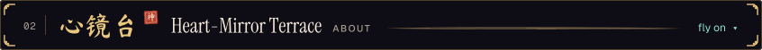</picture></a></p>

<p><picture><source media="(max-width: 600px)" srcset="assets/mirror/card-phone.svg"><source media="(prefers-color-scheme: light)" srcset="assets/mirror/card-light.svg"></picture></p>

<p align="center"><i>"I build voice-first agents. I care about latency, keeping a human in the loop, and what happens when the model is wrong."</i></p>

<a id="forge"></a><a id="ships"></a>
<p><a href="#arena"><picture><source media="(max-width: 600px)" srcset="assets/banners/03-forge-phone.svg"><source media="(prefers-color-scheme: light)" srcset="assets/banners/03-forge-light.svg">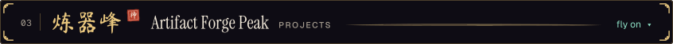</picture></a></p>

<p align="center">Forged in weekend furnaces, mostly: the four newest artifacts to come out of the arena. Each one links to its source.</p>

<!-- HACKLOG:START -->
<p align="center"><a href="https://github.com/aurelisajuan/TalkTuahBank"><picture><source media="(max-width: 600px)" srcset="https://raw.githubusercontent.com/IdkwhatImD0ing/IdkwhatImD0ing/04bff9e53ca0134fdf165f20cea9939bfda1b205/assets/forge/talktuahbank-phone.svg"><source media="(prefers-color-scheme: light)" srcset="https://raw.githubusercontent.com/IdkwhatImD0ing/IdkwhatImD0ing/04bff9e53ca0134fdf165f20cea9939bfda1b205/assets/forge/talktuahbank-light.svg"></picture></a><a href="https://github.com/IdkwhatImD0ing/DispatchAI"><picture><source media="(max-width: 600px)" srcset="https://raw.githubusercontent.com/IdkwhatImD0ing/IdkwhatImD0ing/04bff9e53ca0134fdf165f20cea9939bfda1b205/assets/forge/dispatchai-phone.svg"><source media="(prefers-color-scheme: light)" srcset="https://raw.githubusercontent.com/IdkwhatImD0ing/IdkwhatImD0ing/04bff9e53ca0134fdf165f20cea9939bfda1b205/assets/forge/dispatchai-light.svg"></picture></a><br>
<a href="https://github.com/IdkwhatImD0ing/AdaptEd"><picture><source media="(max-width: 600px)" srcset="https://raw.githubusercontent.com/IdkwhatImD0ing/IdkwhatImD0ing/04bff9e53ca0134fdf165f20cea9939bfda1b205/assets/forge/adapted-phone.svg"><source media="(prefers-color-scheme: light)" srcset="https://raw.githubusercontent.com/IdkwhatImD0ing/IdkwhatImD0ing/04bff9e53ca0134fdf165f20cea9939bfda1b205/assets/forge/adapted-light.svg"></picture></a><a href="https://github.com/SlugLoop/SlugLoop"><picture><source media="(max-width: 600px)" srcset="https://raw.githubusercontent.com/IdkwhatImD0ing/IdkwhatImD0ing/04bff9e53ca0134fdf165f20cea9939bfda1b205/assets/forge/slugloop-phone.svg"><source media="(prefers-color-scheme: light)" srcset="https://raw.githubusercontent.com/IdkwhatImD0ing/IdkwhatImD0ing/04bff9e53ca0134fdf165f20cea9939bfda1b205/assets/forge/slugloop-light.svg"></picture></a></p>
<!-- HACKLOG:END -->

<a id="arena"></a>
<p><a href="#mission"><picture><source media="(max-width: 600px)" srcset="assets/banners/04-arena-phone.svg"><source media="(prefers-color-scheme: light)" srcset="assets/banners/04-arena-light.svg">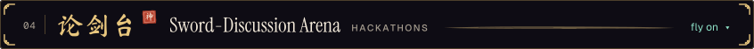</picture></a></p>

<p><picture><source media="(max-width: 600px)" srcset="https://raw.githubusercontent.com/IdkwhatImD0ing/IdkwhatImD0ing/04bff9e53ca0134fdf165f20cea9939bfda1b205/assets/arena/record-phone.svg"><source media="(prefers-color-scheme: light)" srcset="https://raw.githubusercontent.com/IdkwhatImD0ing/IdkwhatImD0ing/04bff9e53ca0134fdf165f20cea9939bfda1b205/assets/arena/record-light.svg"></picture></p>

<p align="center">Most of the 35 wins came in college. He still enters a few a year, and judged LA Hacks 2026. His hackathon builds are listed on <a href="https://devpost.com/IdkwhatImD0ing">Devpost</a>.</p>

<a id="mission"></a>
<p><a href="#library"><picture><source media="(max-width: 600px)" srcset="assets/banners/05-mission-phone.svg"><source media="(prefers-color-scheme: light)" srcset="assets/banners/05-mission-light.svg">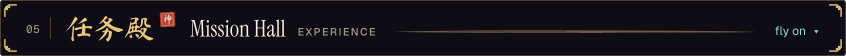</picture></a></p>

<pre><b>任务簿 the mission roster · where the Sect Leader has served</b>
2026-now   Pinterest      Software Engineer II. LLM agent systems:
                          agent design, tool use, RAG, guardrails.
2025-2026  Scale AI       Applied AI, forward-deployed. Multi-agent
                          claims system, up to 20K claims a week.
2023-2025  RingCentral    AI engineer. LLM evals for 10,000+ weekly
                          support chats; 8 hours of processing to 1.
2024       Dispatch AI    Co-founder. Voice agent for 911 dispatch;
                          $50K raised via Berkeley SkyDeck and AIC.
2023-2024  SlugLoop       Founder. UCSC's bus tracker, 20,000+ users.
2022-2023  X-Camp         Taught Python; coached USACO students.

the full jade slip (résumé): <a href="https://art3m1s.me/resume.pdf">art3m1s.me/resume.pdf</a></pre>

<p align="center">The steward posts what the Sect Leader is working on now. The steward is an LLM: twice a week it reads his public GitHub activity and rewrites this board.</p>

<p><picture><source media="(max-width: 600px)" srcset="assets/hall/board-phone.svg"><source media="(prefers-color-scheme: light)" srcset="assets/hall/board-light.svg"></picture></p>

<a id="library"></a>
<p><a href="#steles"><picture><source media="(max-width: 600px)" srcset="assets/banners/06-library-phone.svg"><source media="(prefers-color-scheme: light)" srcset="assets/banners/06-library-light.svg">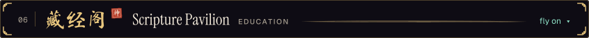</picture></a></p>

<pre><b>藏经阁 scripture pavilion · what the sect has studied</b>
USC    M.S. Computer Science, AI specialization     2023-2025
UCSC   B.S. Computer Science, finished in 2.5 years  2020-2023

the sect's own manual   <a href="https://thehackathonplaybook.dev">The Hackathon Playbook</a>
recorded sermons        <a href="https://www.youtube.com/@hackable-projects">hackable projects</a>, on YouTube</pre>

<details>
<summary>the back shelves: relics of the sect's previous life</summary>

<pre><b>scrolls nobody asked to see</b>
<a href="https://github.com/IdkwhatImD0ing/IdkwhatImD0ing/blob/04bff9e53ca0134fdf165f20cea9939bfda1b205/.plan">.plan</a>          the Sect Leader's own log. plain text
<a href="https://github.com/IdkwhatImD0ing/IdkwhatImD0ing/blob/04bff9e53ca0134fdf165f20cea9939bfda1b205/man/bill.1.md">bill.1</a>         a manual from the previous life. still accurate
<a href="https://github.com/IdkwhatImD0ing/IdkwhatImD0ing/blob/04bff9e53ca0134fdf165f20cea9939bfda1b205/README.md.bak">README.md.bak</a>  the first draft. the elders burned it; this is the ash
<a href="https://github.com/IdkwhatImD0ing/IdkwhatImD0ing/tree/04bff9e53ca0134fdf165f20cea9939bfda1b205/archive/whitebox-os">archive/</a>       the ruins: this page when it was a machine called tianni
heimuling.stl  黑木令, the Black Wood Token. drag to turn it (below)</pre>

```stl
solid heimuling
facet normal 0 0 1
  outer loop
    vertex -13 -30 6
    vertex 13 -30 6
    vertex 20 -23 6
  endloop
endfacet
facet normal 0 0 -1
  outer loop
    vertex -13 -30 0
    vertex 20 -23 0
    vertex 13 -30 0
  endloop
endfacet
facet normal 0 0 1
  outer loop
    vertex -13 -30 6
    vertex 20 -23 6
    vertex 20 23 6
  endloop
endfacet
facet normal 0 0 -1
  outer loop
    vertex -13 -30 0
    vertex 20 23 0
    vertex 20 -23 0
  endloop
endfacet
facet normal 0 0 1
  outer loop
    vertex -13 -30 6
    vertex 20 23 6
    vertex 13 30 6
  endloop
endfacet
facet normal 0 0 -1
  outer loop
    vertex -13 -30 0
    vertex 13 30 0
    vertex 20 23 0
  endloop
endfacet
facet normal 0 0 1
  outer loop
    vertex -13 -30 6
    vertex 13 30 6
    vertex -13 30 6
  endloop
endfacet
facet normal 0 0 -1
  outer loop
    vertex -13 -30 0
    vertex -13 30 0
    vertex 13 30 0
  endloop
endfacet
facet normal 0 0 1
  outer loop
    vertex -13 -30 6
    vertex -13 30 6
    vertex -20 23 6
  endloop
endfacet
facet normal 0 0 -1
  outer loop
    vertex -13 -30 0
    vertex -20 23 0
    vertex -13 30 0
  endloop
endfacet
facet normal 0 0 1
  outer loop
    vertex -13 -30 6
    vertex -20 23 6
    vertex -20 -23 6
  endloop
endfacet
facet normal 0 0 -1
  outer loop
    vertex -13 -30 0
    vertex -20 -23 0
    vertex -20 23 0
  endloop
endfacet
facet normal 0 -1 0
  outer loop
    vertex -13 -30 0
    vertex 13 -30 0
    vertex 13 -30 6
  endloop
endfacet
facet normal 0 -1 0
  outer loop
    vertex -13 -30 0
    vertex 13 -30 6
    vertex -13 -30 6
  endloop
endfacet
facet normal 0.707 -0.707 0
  outer loop
    vertex 13 -30 0
    vertex 20 -23 0
    vertex 20 -23 6
  endloop
endfacet
facet normal 0.707 -0.707 0
  outer loop
    vertex 13 -30 0
    vertex 20 -23 6
    vertex 13 -30 6
  endloop
endfacet
facet normal 1 0 0
  outer loop
    vertex 20 -23 0
    vertex 20 23 0
    vertex 20 23 6
  endloop
endfacet
facet normal 1 0 0
  outer loop
    vertex 20 -23 0
    vertex 20 23 6
    vertex 20 -23 6
  endloop
endfacet
facet normal 0.707 0.707 0
  outer loop
    vertex 20 23 0
    vertex 13 30 0
    vertex 13 30 6
  endloop
endfacet
facet normal 0.707 0.707 0
  outer loop
    vertex 20 23 0
    vertex 13 30 6
    vertex 20 23 6
  endloop
endfacet
facet normal 0 1 0
  outer loop
    vertex 13 30 0
    vertex -13 30 0
    vertex -13 30 6
  endloop
endfacet
facet normal 0 1 0
  outer loop
    vertex 13 30 0
    vertex -13 30 6
    vertex 13 30 6
  endloop
endfacet
facet normal -0.707 0.707 0
  outer loop
    vertex -13 30 0
    vertex -20 23 0
    vertex -20 23 6
  endloop
endfacet
facet normal -0.707 0.707 0
  outer loop
    vertex -13 30 0
    vertex -20 23 6
    vertex -13 30 6
  endloop
endfacet
facet normal -1 0 0
  outer loop
    vertex -20 23 0
    vertex -20 -23 0
    vertex -20 -23 6
  endloop
endfacet
facet normal -1 0 0
  outer loop
    vertex -20 23 0
    vertex -20 -23 6
    vertex -20 23 6
  endloop
endfacet
facet normal -0.707 -0.707 0
  outer loop
    vertex -20 -23 0
    vertex -13 -30 0
    vertex -13 -30 6
  endloop
endfacet
facet normal -0.707 -0.707 0
  outer loop
    vertex -20 -23 0
    vertex -13 -30 6
    vertex -20 -23 6
  endloop
endfacet
facet normal 0 0 1
  outer loop
    vertex -11.702 -27.8 7
    vertex 11.702 -27.8 7
    vertex 10.404 -25.6 7
  endloop
endfacet
facet normal 0 0 -1
  outer loop
    vertex -11.702 -27.8 6
    vertex 10.404 -25.6 6
    vertex 11.702 -27.8 6
  endloop
endfacet
facet normal 0 0 1
  outer loop
    vertex -11.702 -27.8 7
    vertex 10.404 -25.6 7
    vertex -10.404 -25.6 7
  endloop
endfacet
facet normal 0 0 -1
  outer loop
    vertex -11.702 -27.8 6
    vertex -10.404 -25.6 6
    vertex 10.404 -25.6 6
  endloop
endfacet
facet normal 0 0 1
  outer loop
    vertex 11.702 -27.8 7
    vertex 17.8 -21.702 7
    vertex 15.6 -20.404 7
  endloop
endfacet
facet normal 0 0 -1
  outer loop
    vertex 11.702 -27.8 6
    vertex 15.6 -20.404 6
    vertex 17.8 -21.702 6
  endloop
endfacet
facet normal 0 0 1
  outer loop
    vertex 11.702 -27.8 7
    vertex 15.6 -20.404 7
    vertex 10.404 -25.6 7
  endloop
endfacet
facet normal 0 0 -1
  outer loop
    vertex 11.702 -27.8 6
    vertex 10.404 -25.6 6
    vertex 15.6 -20.404 6
  endloop
endfacet
facet normal 0 0 1
  outer loop
    vertex 17.8 -21.702 7
    vertex 17.8 21.702 7
    vertex 15.6 20.404 7
  endloop
endfacet
facet normal 0 0 -1
  outer loop
    vertex 17.8 -21.702 6
    vertex 15.6 20.404 6
    vertex 17.8 21.702 6
  endloop
endfacet
facet normal 0 0 1
  outer loop
    vertex 17.8 -21.702 7
    vertex 15.6 20.404 7
    vertex 15.6 -20.404 7
  endloop
endfacet
facet normal 0 0 -1
  outer loop
    vertex 17.8 -21.702 6
    vertex 15.6 -20.404 6
    vertex 15.6 20.404 6
  endloop
endfacet
facet normal 0 0 1
  outer loop
    vertex 17.8 21.702 7
    vertex 11.702 27.8 7
    vertex 10.404 25.6 7
  endloop
endfacet
facet normal 0 0 -1
  outer loop
    vertex 17.8 21.702 6
    vertex 10.404 25.6 6
    vertex 11.702 27.8 6
  endloop
endfacet
facet normal 0 0 1
  outer loop
    vertex 17.8 21.702 7
    vertex 10.404 25.6 7
    vertex 15.6 20.404 7
  endloop
endfacet
facet normal 0 0 -1
  outer loop
    vertex 17.8 21.702 6
    vertex 15.6 20.404 6
    vertex 10.404 25.6 6
  endloop
endfacet
facet normal 0 0 1
  outer loop
    vertex 11.702 27.8 7
    vertex -11.702 27.8 7
    vertex -10.404 25.6 7
  endloop
endfacet
facet normal 0 0 -1
  outer loop
    vertex 11.702 27.8 6
    vertex -10.404 25.6 6
    vertex -11.702 27.8 6
  endloop
endfacet
facet normal 0 0 1
  outer loop
    vertex 11.702 27.8 7
    vertex -10.404 25.6 7
    vertex 10.404 25.6 7
  endloop
endfacet
facet normal 0 0 -1
  outer loop
    vertex 11.702 27.8 6
    vertex 10.404 25.6 6
    vertex -10.404 25.6 6
  endloop
endfacet
facet normal 0 0 1
  outer loop
    vertex -11.702 27.8 7
    vertex -17.8 21.702 7
    vertex -15.6 20.404 7
  endloop
endfacet
facet normal 0 0 -1
  outer loop
    vertex -11.702 27.8 6
    vertex -15.6 20.404 6
    vertex -17.8 21.702 6
  endloop
endfacet
facet normal 0 0 1
  outer loop
    vertex -11.702 27.8 7
    vertex -15.6 20.404 7
    vertex -10.404 25.6 7
  endloop
endfacet
facet normal 0 0 -1
  outer loop
    vertex -11.702 27.8 6
    vertex -10.404 25.6 6
    vertex -15.6 20.404 6
  endloop
endfacet
facet normal 0 0 1
  outer loop
    vertex -17.8 21.702 7
    vertex -17.8 -21.702 7
    vertex -15.6 -20.404 7
  endloop
endfacet
facet normal 0 0 -1
  outer loop
    vertex -17.8 21.702 6
    vertex -15.6 -20.404 6
    vertex -17.8 -21.702 6
  endloop
endfacet
facet normal 0 0 1
  outer loop
    vertex -17.8 21.702 7
    vertex -15.6 -20.404 7
    vertex -15.6 20.404 7
  endloop
endfacet
facet normal 0 0 -1
  outer loop
    vertex -17.8 21.702 6
    vertex -15.6 20.404 6
    vertex -15.6 -20.404 6
  endloop
endfacet
facet normal 0 0 1
  outer loop
    vertex -17.8 -21.702 7
    vertex -11.702 -27.8 7
    vertex -10.404 -25.6 7
  endloop
endfacet
facet normal 0 0 -1
  outer loop
    vertex -17.8 -21.702 6
    vertex -10.404 -25.6 6
    vertex -11.702 -27.8 6
  endloop
endfacet
facet normal 0 0 1
  outer loop
    vertex -17.8 -21.702 7
    vertex -10.404 -25.6 7
    vertex -15.6 -20.404 7
  endloop
endfacet
facet normal 0 0 -1
  outer loop
    vertex -17.8 -21.702 6
    vertex -15.6 -20.404 6
    vertex -10.404 -25.6 6
  endloop
endfacet
facet normal 0 -1 0
  outer loop
    vertex -11.702 -27.8 6
    vertex 11.702 -27.8 6
    vertex 11.702 -27.8 7
  endloop
endfacet
facet normal 0 -1 0
  outer loop
    vertex -11.702 -27.8 6
    vertex 11.702 -27.8 7
    vertex -11.702 -27.8 7
  endloop
endfacet
facet normal 0.707 -0.707 0
  outer loop
    vertex 11.702 -27.8 6
    vertex 17.8 -21.702 6
    vertex 17.8 -21.702 7
  endloop
endfacet
facet normal 0.707 -0.707 0
  outer loop
    vertex 11.702 -27.8 6
    vertex 17.8 -21.702 7
    vertex 11.702 -27.8 7
  endloop
endfacet
facet normal 1 0 0
  outer loop
    vertex 17.8 -21.702 6
    vertex 17.8 21.702 6
    vertex 17.8 21.702 7
  endloop
endfacet
facet normal 1 0 0
  outer loop
    vertex 17.8 -21.702 6
    vertex 17.8 21.702 7
    vertex 17.8 -21.702 7
  endloop
endfacet
facet normal 0.707 0.707 0
  outer loop
    vertex 17.8 21.702 6
    vertex 11.702 27.8 6
    vertex 11.702 27.8 7
  endloop
endfacet
facet normal 0.707 0.707 0
  outer loop
    vertex 17.8 21.702 6
    vertex 11.702 27.8 7
    vertex 17.8 21.702 7
  endloop
endfacet
facet normal 0 1 0
  outer loop
    vertex 11.702 27.8 6
    vertex -11.702 27.8 6
    vertex -11.702 27.8 7
  endloop
endfacet
facet normal 0 1 0
  outer loop
    vertex 11.702 27.8 6
    vertex -11.702 27.8 7
    vertex 11.702 27.8 7
  endloop
endfacet
facet normal -0.707 0.707 0
  outer loop
    vertex -11.702 27.8 6
    vertex -17.8 21.702 6
    vertex -17.8 21.702 7
  endloop
endfacet
facet normal -0.707 0.707 0
  outer loop
    vertex -11.702 27.8 6
    vertex -17.8 21.702 7
    vertex -11.702 27.8 7
  endloop
endfacet
facet normal -1 0 0
  outer loop
    vertex -17.8 21.702 6
    vertex -17.8 -21.702 6
    vertex -17.8 -21.702 7
  endloop
endfacet
facet normal -1 0 0
  outer loop
    vertex -17.8 21.702 6
    vertex -17.8 -21.702 7
    vertex -17.8 21.702 7
  endloop
endfacet
facet normal -0.707 -0.707 0
  outer loop
    vertex -17.8 -21.702 6
    vertex -11.702 -27.8 6
    vertex -11.702 -27.8 7
  endloop
endfacet
facet normal -0.707 -0.707 0
  outer loop
    vertex -17.8 -21.702 6
    vertex -11.702 -27.8 7
    vertex -17.8 -21.702 7
  endloop
endfacet
facet normal 1 0 0
  outer loop
    vertex -15.6 -20.404 6
    vertex -15.6 20.404 6
    vertex -15.6 20.404 7
  endloop
endfacet
facet normal 1 0 0
  outer loop
    vertex -15.6 -20.404 6
    vertex -15.6 20.404 7
    vertex -15.6 -20.404 7
  endloop
endfacet
facet normal 0.707 -0.707 0
  outer loop
    vertex -15.6 20.404 6
    vertex -10.404 25.6 6
    vertex -10.404 25.6 7
  endloop
endfacet
facet normal 0.707 -0.707 0
  outer loop
    vertex -15.6 20.404 6
    vertex -10.404 25.6 7
    vertex -15.6 20.404 7
  endloop
endfacet
facet normal 0 -1 0
  outer loop
    vertex -10.404 25.6 6
    vertex 10.404 25.6 6
    vertex 10.404 25.6 7
  endloop
endfacet
facet normal 0 -1 0
  outer loop
    vertex -10.404 25.6 6
    vertex 10.404 25.6 7
    vertex -10.404 25.6 7
  endloop
endfacet
facet normal -0.707 -0.707 0
  outer loop
    vertex 10.404 25.6 6
    vertex 15.6 20.404 6
    vertex 15.6 20.404 7
  endloop
endfacet
facet normal -0.707 -0.707 0
  outer loop
    vertex 10.404 25.6 6
    vertex 15.6 20.404 7
    vertex 10.404 25.6 7
  endloop
endfacet
facet normal -1 0 0
  outer loop
    vertex 15.6 20.404 6
    vertex 15.6 -20.404 6
    vertex 15.6 -20.404 7
  endloop
endfacet
facet normal -1 0 0
  outer loop
    vertex 15.6 20.404 6
    vertex 15.6 -20.404 7
    vertex 15.6 20.404 7
  endloop
endfacet
facet normal -0.707 0.707 0
  outer loop
    vertex 15.6 -20.404 6
    vertex 10.404 -25.6 6
    vertex 10.404 -25.6 7
  endloop
endfacet
facet normal -0.707 0.707 0
  outer loop
    vertex 15.6 -20.404 6
    vertex 10.404 -25.6 7
    vertex 15.6 -20.404 7
  endloop
endfacet
facet normal 0 1 0
  outer loop
    vertex 10.404 -25.6 6
    vertex -10.404 -25.6 6
    vertex -10.404 -25.6 7
  endloop
endfacet
facet normal 0 1 0
  outer loop
    vertex 10.404 -25.6 6
    vertex -10.404 -25.6 7
    vertex 10.404 -25.6 7
  endloop
endfacet
facet normal 0.707 0.707 0
  outer loop
    vertex -10.404 -25.6 6
    vertex -15.6 -20.404 6
    vertex -15.6 -20.404 7
  endloop
endfacet
facet normal 0.707 0.707 0
  outer loop
    vertex -10.404 -25.6 6
    vertex -15.6 -20.404 7
    vertex -10.404 -25.6 7
  endloop
endfacet
facet normal 0 0 1
  outer loop
    vertex -5.405 13.322 8.2
    vertex -10.799 10.935 8.2
    vertex -7.306 10.461 8.2
  endloop
endfacet
facet normal 0 0 -1
  outer loop
    vertex -5.405 13.322 6
    vertex -7.306 10.461 6
    vertex -10.799 10.935 6
  endloop
endfacet
facet normal 0 0 1
  outer loop
    vertex -10.799 10.935 8.2
    vertex -14.458 6.309 8.2
    vertex -8.134 7.128 8.2
  endloop
endfacet
facet normal 0 0 -1
  outer loop
    vertex -10.799 10.935 6
    vertex -8.134 7.128 6
    vertex -14.458 6.309 6
  endloop
endfacet
facet normal 0 0 1
  outer loop
    vertex -10.799 10.935 8.2
    vertex -8.134 7.128 8.2
    vertex -7.306 10.461 8.2
  endloop
endfacet
facet normal 0 0 -1
  outer loop
    vertex -10.799 10.935 6
    vertex -7.306 10.461 6
    vertex -8.134 7.128 6
  endloop
endfacet
facet normal 0 0 1
  outer loop
    vertex -14.458 6.309 8.2
    vertex -15.539 0.511 8.2
    vertex -7.793 3.71 8.2
  endloop
endfacet
facet normal 0 0 -1
  outer loop
    vertex -14.458 6.309 6
    vertex -7.793 3.71 6
    vertex -15.539 0.511 6
  endloop
endfacet
facet normal 0 0 1
  outer loop
    vertex -14.458 6.309 8.2
    vertex -7.793 3.71 8.2
    vertex -8.134 7.128 8.2
  endloop
endfacet
facet normal 0 0 -1
  outer loop
    vertex -14.458 6.309 6
    vertex -8.134 7.128 6
    vertex -7.793 3.71 6
  endloop
endfacet
facet normal 0 0 1
  outer loop
    vertex -15.539 0.511 8.2
    vertex -13.793 -5.123 8.2
    vertex -6.322 0.606 8.2
  endloop
endfacet
facet normal 0 0 -1
  outer loop
    vertex -15.539 0.511 6
    vertex -6.322 0.606 6
    vertex -13.793 -5.123 6
  endloop
endfacet
facet normal 0 0 1
  outer loop
    vertex -15.539 0.511 8.2
    vertex -6.322 0.606 8.2
    vertex -7.793 3.71 8.2
  endloop
endfacet
facet normal 0 0 -1
  outer loop
    vertex -15.539 0.511 6
    vertex -7.793 3.71 6
    vertex -6.322 0.606 6
  endloop
endfacet
facet normal 0 0 1
  outer loop
    vertex -13.793 -5.123 8.2
    vertex -9.623 -9.293 8.2
    vertex -3.894 -1.822 8.2
  endloop
endfacet
facet normal 0 0 -1
  outer loop
    vertex -13.793 -5.123 6
    vertex -3.894 -1.822 6
    vertex -9.623 -9.293 6
  endloop
endfacet
facet normal 0 0 1
  outer loop
    vertex -13.793 -5.123 8.2
    vertex -3.894 -1.822 8.2
    vertex -6.322 0.606 8.2
  endloop
endfacet
facet normal 0 0 -1
  outer loop
    vertex -13.793 -5.123 6
    vertex -6.322 0.606 6
    vertex -3.894 -1.822 6
  endloop
endfacet
facet normal 0 0 1
  outer loop
    vertex -9.623 -9.293 8.2
    vertex -3.989 -11.039 8.2
    vertex -0.79 -3.293 8.2
  endloop
endfacet
facet normal 0 0 -1
  outer loop
    vertex -9.623 -9.293 6
    vertex -0.79 -3.293 6
    vertex -3.989 -11.039 6
  endloop
endfacet
facet normal 0 0 1
  outer loop
    vertex -9.623 -9.293 8.2
    vertex -0.79 -3.293 8.2
    vertex -3.894 -1.822 8.2
  endloop
endfacet
facet normal 0 0 -1
  outer loop
    vertex -9.623 -9.293 6
    vertex -3.894 -1.822 6
    vertex -0.79 -3.293 6
  endloop
endfacet
facet normal 0 0 1
  outer loop
    vertex -3.989 -11.039 8.2
    vertex 1.809 -9.958 8.2
    vertex 2.628 -3.634 8.2
  endloop
endfacet
facet normal 0 0 -1
  outer loop
    vertex -3.989 -11.039 6
    vertex 2.628 -3.634 6
    vertex 1.809 -9.958 6
  endloop
endfacet
facet normal 0 0 1
  outer loop
    vertex -3.989 -11.039 8.2
    vertex 2.628 -3.634 8.2
    vertex -0.79 -3.293 8.2
  endloop
endfacet
facet normal 0 0 -1
  outer loop
    vertex -3.989 -11.039 6
    vertex -0.79 -3.293 6
    vertex 2.628 -3.634 6
  endloop
endfacet
facet normal 0 0 1
  outer loop
    vertex 1.809 -9.958 8.2
    vertex 6.435 -6.299 8.2
    vertex 5.961 -2.806 8.2
  endloop
endfacet
facet normal 0 0 -1
  outer loop
    vertex 1.809 -9.958 6
    vertex 5.961 -2.806 6
    vertex 6.435 -6.299 6
  endloop
endfacet
facet normal 0 0 1
  outer loop
    vertex 1.809 -9.958 8.2
    vertex 5.961 -2.806 8.2
    vertex 2.628 -3.634 8.2
  endloop
endfacet
facet normal 0 0 -1
  outer loop
    vertex 1.809 -9.958 6
    vertex 2.628 -3.634 6
    vertex 5.961 -2.806 6
  endloop
endfacet
facet normal 0 0 1
  outer loop
    vertex 6.435 -6.299 8.2
    vertex 8.822 -0.905 8.2
    vertex 5.961 -2.806 8.2
  endloop
endfacet
facet normal 0 0 -1
  outer loop
    vertex 6.435 -6.299 6
    vertex 5.961 -2.806 6
    vertex 8.822 -0.905 6
  endloop
endfacet
facet normal -0.405 0.914 0
  outer loop
    vertex -5.405 13.322 6
    vertex -10.799 10.935 6
    vertex -10.799 10.935 8.2
  endloop
endfacet
facet normal -0.405 0.914 0
  outer loop
    vertex -5.405 13.322 6
    vertex -10.799 10.935 8.2
    vertex -5.405 13.322 8.2
  endloop
endfacet
facet normal -0.784 0.62 0
  outer loop
    vertex -10.799 10.935 6
    vertex -14.458 6.309 6
    vertex -14.458 6.309 8.2
  endloop
endfacet
facet normal -0.784 0.62 0
  outer loop
    vertex -10.799 10.935 6
    vertex -14.458 6.309 8.2
    vertex -10.799 10.935 8.2
  endloop
endfacet
facet normal -0.983 0.183 0
  outer loop
    vertex -14.458 6.309 6
    vertex -15.539 0.511 6
    vertex -15.539 0.511 8.2
  endloop
endfacet
facet normal -0.983 0.183 0
  outer loop
    vertex -14.458 6.309 6
    vertex -15.539 0.511 8.2
    vertex -14.458 6.309 8.2
  endloop
endfacet
facet normal -0.955 -0.296 0
  outer loop
    vertex -15.539 0.511 6
    vertex -13.793 -5.123 6
    vertex -13.793 -5.123 8.2
  endloop
endfacet
facet normal -0.955 -0.296 0
  outer loop
    vertex -15.539 0.511 6
    vertex -13.793 -5.123 8.2
    vertex -15.539 0.511 8.2
  endloop
endfacet
facet normal -0.707 -0.707 0
  outer loop
    vertex -13.793 -5.123 6
    vertex -9.623 -9.293 6
    vertex -9.623 -9.293 8.2
  endloop
endfacet
facet normal -0.707 -0.707 0
  outer loop
    vertex -13.793 -5.123 6
    vertex -9.623 -9.293 8.2
    vertex -13.793 -5.123 8.2
  endloop
endfacet
facet normal -0.296 -0.955 0
  outer loop
    vertex -9.623 -9.293 6
    vertex -3.989 -11.039 6
    vertex -3.989 -11.039 8.2
  endloop
endfacet
facet normal -0.296 -0.955 0
  outer loop
    vertex -9.623 -9.293 6
    vertex -3.989 -11.039 8.2
    vertex -9.623 -9.293 8.2
  endloop
endfacet
facet normal 0.183 -0.983 0
  outer loop
    vertex -3.989 -11.039 6
    vertex 1.809 -9.958 6
    vertex 1.809 -9.958 8.2
  endloop
endfacet
facet normal 0.183 -0.983 0
  outer loop
    vertex -3.989 -11.039 6
    vertex 1.809 -9.958 8.2
    vertex -3.989 -11.039 8.2
  endloop
endfacet
facet normal 0.62 -0.784 0
  outer loop
    vertex 1.809 -9.958 6
    vertex 6.435 -6.299 6
    vertex 6.435 -6.299 8.2
  endloop
endfacet
facet normal 0.62 -0.784 0
  outer loop
    vertex 1.809 -9.958 6
    vertex 6.435 -6.299 8.2
    vertex 1.809 -9.958 8.2
  endloop
endfacet
facet normal 0.914 -0.405 0
  outer loop
    vertex 6.435 -6.299 6
    vertex 8.822 -0.905 6
    vertex 8.822 -0.905 8.2
  endloop
endfacet
facet normal 0.914 -0.405 0
  outer loop
    vertex 6.435 -6.299 6
    vertex 8.822 -0.905 8.2
    vertex 6.435 -6.299 8.2
  endloop
endfacet
facet normal -0.553 0.833 0
  outer loop
    vertex 8.822 -0.905 6
    vertex 5.961 -2.806 6
    vertex 5.961 -2.806 8.2
  endloop
endfacet
facet normal -0.553 0.833 0
  outer loop
    vertex 8.822 -0.905 6
    vertex 5.961 -2.806 8.2
    vertex 8.822 -0.905 8.2
  endloop
endfacet
facet normal -0.241 0.971 0
  outer loop
    vertex 5.961 -2.806 6
    vertex 2.628 -3.634 6
    vertex 2.628 -3.634 8.2
  endloop
endfacet
facet normal -0.241 0.971 0
  outer loop
    vertex 5.961 -2.806 6
    vertex 2.628 -3.634 8.2
    vertex 5.961 -2.806 8.2
  endloop
endfacet
facet normal 0.099 0.995 0
  outer loop
    vertex 2.628 -3.634 6
    vertex -0.79 -3.293 6
    vertex -0.79 -3.293 8.2
  endloop
endfacet
facet normal 0.099 0.995 0
  outer loop
    vertex 2.628 -3.634 6
    vertex -0.79 -3.293 8.2
    vertex 2.628 -3.634 8.2
  endloop
endfacet
facet normal 0.428 0.904 0
  outer loop
    vertex -0.79 -3.293 6
    vertex -3.894 -1.822 6
    vertex -3.894 -1.822 8.2
  endloop
endfacet
facet normal 0.428 0.904 0
  outer loop
    vertex -0.79 -3.293 6
    vertex -3.894 -1.822 8.2
    vertex -0.79 -3.293 8.2
  endloop
endfacet
facet normal 0.707 0.707 0
  outer loop
    vertex -3.894 -1.822 6
    vertex -6.322 0.606 6
    vertex -6.322 0.606 8.2
  endloop
endfacet
facet normal 0.707 0.707 0
  outer loop
    vertex -3.894 -1.822 6
    vertex -6.322 0.606 8.2
    vertex -3.894 -1.822 8.2
  endloop
endfacet
facet normal 0.904 0.428 0
  outer loop
    vertex -6.322 0.606 6
    vertex -7.793 3.71 6
    vertex -7.793 3.71 8.2
  endloop
endfacet
facet normal 0.904 0.428 0
  outer loop
    vertex -6.322 0.606 6
    vertex -7.793 3.71 8.2
    vertex -6.322 0.606 8.2
  endloop
endfacet
facet normal 0.995 0.099 0
  outer loop
    vertex -7.793 3.71 6
    vertex -8.134 7.128 6
    vertex -8.134 7.128 8.2
  endloop
endfacet
facet normal 0.995 0.099 0
  outer loop
    vertex -7.793 3.71 6
    vertex -8.134 7.128 8.2
    vertex -7.793 3.71 8.2
  endloop
endfacet
facet normal 0.971 -0.241 0
  outer loop
    vertex -8.134 7.128 6
    vertex -7.306 10.461 6
    vertex -7.306 10.461 8.2
  endloop
endfacet
facet normal 0.971 -0.241 0
  outer loop
    vertex -8.134 7.128 6
    vertex -7.306 10.461 8.2
    vertex -8.134 7.128 8.2
  endloop
endfacet
facet normal 0.833 -0.553 0
  outer loop
    vertex -7.306 10.461 6
    vertex -5.405 13.322 6
    vertex -5.405 13.322 8.2
  endloop
endfacet
facet normal 0.833 -0.553 0
  outer loop
    vertex -7.306 10.461 6
    vertex -5.405 13.322 8.2
    vertex -7.306 10.461 8.2
  endloop
endfacet
facet normal 0 0 1
  outer loop
    vertex 7.676 8.476 8.8
    vertex 6.592 11.092 8.8
    vertex 3.976 12.176 8.8
  endloop
endfacet
facet normal 0 0 -1
  outer loop
    vertex 7.676 8.476 6
    vertex 3.976 12.176 6
    vertex 6.592 11.092 6
  endloop
endfacet
facet normal 0 0 1
  outer loop
    vertex 7.676 8.476 8.8
    vertex 3.976 12.176 8.8
    vertex 1.36 11.092 8.8
  endloop
endfacet
facet normal 0 0 -1
  outer loop
    vertex 7.676 8.476 6
    vertex 1.36 11.092 6
    vertex 3.976 12.176 6
  endloop
endfacet
facet normal 0 0 1
  outer loop
    vertex 7.676 8.476 8.8
    vertex 1.36 11.092 8.8
    vertex 0.276 8.476 8.8
  endloop
endfacet
facet normal 0 0 -1
  outer loop
    vertex 7.676 8.476 6
    vertex 0.276 8.476 6
    vertex 1.36 11.092 6
  endloop
endfacet
facet normal 0 0 1
  outer loop
    vertex 7.676 8.476 8.8
    vertex 0.276 8.476 8.8
    vertex 1.36 5.86 8.8
  endloop
endfacet
facet normal 0 0 -1
  outer loop
    vertex 7.676 8.476 6
    vertex 1.36 5.86 6
    vertex 0.276 8.476 6
  endloop
endfacet
facet normal 0 0 1
  outer loop
    vertex 7.676 8.476 8.8
    vertex 1.36 5.86 8.8
    vertex 3.976 4.776 8.8
  endloop
endfacet
facet normal 0 0 -1
  outer loop
    vertex 7.676 8.476 6
    vertex 3.976 4.776 6
    vertex 1.36 5.86 6
  endloop
endfacet
facet normal 0 0 1
  outer loop
    vertex 7.676 8.476 8.8
    vertex 3.976 4.776 8.8
    vertex 6.592 5.86 8.8
  endloop
endfacet
facet normal 0 0 -1
  outer loop
    vertex 7.676 8.476 6
    vertex 6.592 5.86 6
    vertex 3.976 4.776 6
  endloop
endfacet
facet normal 0.924 0.383 0
  outer loop
    vertex 7.676 8.476 6
    vertex 6.592 11.092 6
    vertex 6.592 11.092 8.8
  endloop
endfacet
facet normal 0.924 0.383 0
  outer loop
    vertex 7.676 8.476 6
    vertex 6.592 11.092 8.8
    vertex 7.676 8.476 8.8
  endloop
endfacet
facet normal 0.383 0.924 0
  outer loop
    vertex 6.592 11.092 6
    vertex 3.976 12.176 6
    vertex 3.976 12.176 8.8
  endloop
endfacet
facet normal 0.383 0.924 0
  outer loop
    vertex 6.592 11.092 6
    vertex 3.976 12.176 8.8
    vertex 6.592 11.092 8.8
  endloop
endfacet
facet normal -0.383 0.924 0
  outer loop
    vertex 3.976 12.176 6
    vertex 1.36 11.092 6
    vertex 1.36 11.092 8.8
  endloop
endfacet
facet normal -0.383 0.924 0
  outer loop
    vertex 3.976 12.176 6
    vertex 1.36 11.092 8.8
    vertex 3.976 12.176 8.8
  endloop
endfacet
facet normal -0.924 0.383 0
  outer loop
    vertex 1.36 11.092 6
    vertex 0.276 8.476 6
    vertex 0.276 8.476 8.8
  endloop
endfacet
facet normal -0.924 0.383 0
  outer loop
    vertex 1.36 11.092 6
    vertex 0.276 8.476 8.8
    vertex 1.36 11.092 8.8
  endloop
endfacet
facet normal -0.924 -0.383 0
  outer loop
    vertex 0.276 8.476 6
    vertex 1.36 5.86 6
    vertex 1.36 5.86 8.8
  endloop
endfacet
facet normal -0.924 -0.383 0
  outer loop
    vertex 0.276 8.476 6
    vertex 1.36 5.86 8.8
    vertex 0.276 8.476 8.8
  endloop
endfacet
facet normal -0.383 -0.924 0
  outer loop
    vertex 1.36 5.86 6
    vertex 3.976 4.776 6
    vertex 3.976 4.776 8.8
  endloop
endfacet
facet normal -0.383 -0.924 0
  outer loop
    vertex 1.36 5.86 6
    vertex 3.976 4.776 8.8
    vertex 1.36 5.86 8.8
  endloop
endfacet
facet normal 0.383 -0.924 0
  outer loop
    vertex 3.976 4.776 6
    vertex 6.592 5.86 6
    vertex 6.592 5.86 8.8
  endloop
endfacet
facet normal 0.383 -0.924 0
  outer loop
    vertex 3.976 4.776 6
    vertex 6.592 5.86 8.8
    vertex 3.976 4.776 8.8
  endloop
endfacet
facet normal 0.924 -0.383 0
  outer loop
    vertex 6.592 5.86 6
    vertex 7.676 8.476 6
    vertex 7.676 8.476 8.8
  endloop
endfacet
facet normal 0.924 -0.383 0
  outer loop
    vertex 6.592 5.86 6
    vertex 7.676 8.476 8.8
    vertex 6.592 5.86 8.8
  endloop
endfacet
endsolid heimuling
```

</details>

<a id="steles"></a>
<p><a href="#formation"><picture><source media="(max-width: 600px)" srcset="assets/banners/07-steles-phone.svg"><source media="(prefers-color-scheme: light)" srcset="assets/banners/07-steles-light.svg">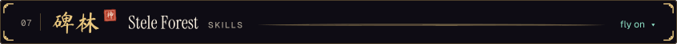</picture></a></p>

<pre><b>碑林 stele forest · carved here, staying carved</b>
llm agents   tool use, RAG, evals, guardrails  (the day job)
voice ai     Retell, ElevenLabs, Hume, Twilio  (hackathon-critical)
typescript   5.x       (load-bearing)
python       3.12      (the other load-bearing one)
react        forever   (dependency of everything)
next.js      latest    (see: react)
fastapi      latest    (default answer)
postgres     16        (where the state lives)
pytorch      2.x       (installed for one weekend, kept forever)
ffmpeg       any       (do not ask what it is wired into)

a stele for sleep was commissioned. it was never carved.</pre>

<a id="formation"></a><a id="fsck"></a>
<p><a href="#abode"><picture><source media="(max-width: 600px)" srcset="assets/banners/08-formation-phone.svg"><source media="(prefers-color-scheme: light)" srcset="assets/banners/08-formation-light.svg">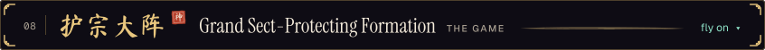</picture></a></p>

<p>The sect's guardian formation: 81 nodes, 10 of them killing traps. Break it by petition: click a node and submit the issue as-is, and the formation answers in about a minute. A number counts the traps touching that node. The first step is always safe.</p>

<!-- FSCK:START -->
<p>
<picture><source media="(max-width: 600px)" srcset="https://raw.githubusercontent.com/IdkwhatImD0ing/IdkwhatImD0ing/04bff9e53ca0134fdf165f20cea9939bfda1b205/assets/formation/panel-0-phone.svg"><source media="(prefers-color-scheme: light)" srcset="https://raw.githubusercontent.com/IdkwhatImD0ing/IdkwhatImD0ing/04bff9e53ca0134fdf165f20cea9939bfda1b205/assets/formation/panel-0-light.svg"></picture><picture><source media="(max-width: 600px)" srcset="https://raw.githubusercontent.com/IdkwhatImD0ing/IdkwhatImD0ing/04bff9e53ca0134fdf165f20cea9939bfda1b205/assets/formation/tiles/dark/cols.svg"><source media="(prefers-color-scheme: light)" srcset="https://raw.githubusercontent.com/IdkwhatImD0ing/IdkwhatImD0ing/04bff9e53ca0134fdf165f20cea9939bfda1b205/assets/formation/tiles/light/cols.svg"></picture><br>
<picture><source media="(max-width: 600px)" srcset="https://raw.githubusercontent.com/IdkwhatImD0ing/IdkwhatImD0ing/04bff9e53ca0134fdf165f20cea9939bfda1b205/assets/formation/tiles/dark/r1.svg"><source media="(prefers-color-scheme: light)" srcset="https://raw.githubusercontent.com/IdkwhatImD0ing/IdkwhatImD0ing/04bff9e53ca0134fdf165f20cea9939bfda1b205/assets/formation/tiles/light/r1.svg"></picture><picture><source media="(max-width: 600px)" srcset="https://raw.githubusercontent.com/IdkwhatImD0ing/IdkwhatImD0ing/04bff9e53ca0134fdf165f20cea9939bfda1b205/assets/formation/tiles/dark/hidden.svg"><source media="(prefers-color-scheme: light)" srcset="https://raw.githubusercontent.com/IdkwhatImD0ing/IdkwhatImD0ing/04bff9e53ca0134fdf165f20cea9939bfda1b205/assets/formation/tiles/light/hidden.svg"></picture><picture><source media="(max-width: 600px)" srcset="https://raw.githubusercontent.com/IdkwhatImD0ing/IdkwhatImD0ing/04bff9e53ca0134fdf165f20cea9939bfda1b205/assets/formation/tiles/dark/hidden.svg"><source media="(prefers-color-scheme: light)" srcset="https://raw.githubusercontent.com/IdkwhatImD0ing/IdkwhatImD0ing/04bff9e53ca0134fdf165f20cea9939bfda1b205/assets/formation/tiles/light/hidden.svg"></picture><picture><source media="(max-width: 600px)" srcset="https://raw.githubusercontent.com/IdkwhatImD0ing/IdkwhatImD0ing/04bff9e53ca0134fdf165f20cea9939bfda1b205/assets/formation/tiles/dark/hidden.svg"><source media="(prefers-color-scheme: light)" srcset="https://raw.githubusercontent.com/IdkwhatImD0ing/IdkwhatImD0ing/04bff9e53ca0134fdf165f20cea9939bfda1b205/assets/formation/tiles/light/hidden.svg"></picture><picture><source media="(max-width: 600px)" srcset="https://raw.githubusercontent.com/IdkwhatImD0ing/IdkwhatImD0ing/04bff9e53ca0134fdf165f20cea9939bfda1b205/assets/formation/tiles/dark/hidden.svg"><source media="(prefers-color-scheme: light)" srcset="https://raw.githubusercontent.com/IdkwhatImD0ing/IdkwhatImD0ing/04bff9e53ca0134fdf165f20cea9939bfda1b205/assets/formation/tiles/light/hidden.svg"></picture><picture><source media="(max-width: 600px)" srcset="https://raw.githubusercontent.com/IdkwhatImD0ing/IdkwhatImD0ing/04bff9e53ca0134fdf165f20cea9939bfda1b205/assets/formation/tiles/dark/hidden.svg"><source media="(prefers-color-scheme: light)" srcset="https://raw.githubusercontent.com/IdkwhatImD0ing/IdkwhatImD0ing/04bff9e53ca0134fdf165f20cea9939bfda1b205/assets/formation/tiles/light/hidden.svg"></picture><picture><source media="(max-width: 600px)" srcset="https://raw.githubusercontent.com/IdkwhatImD0ing/IdkwhatImD0ing/04bff9e53ca0134fdf165f20cea9939bfda1b205/assets/formation/tiles/dark/hidden.svg"><source media="(prefers-color-scheme: light)" srcset="https://raw.githubusercontent.com/IdkwhatImD0ing/IdkwhatImD0ing/04bff9e53ca0134fdf165f20cea9939bfda1b205/assets/formation/tiles/light/hidden.svg"></picture><picture><source media="(max-width: 600px)" srcset="https://raw.githubusercontent.com/IdkwhatImD0ing/IdkwhatImD0ing/04bff9e53ca0134fdf165f20cea9939bfda1b205/assets/formation/tiles/dark/hidden.svg"><source media="(prefers-color-scheme: light)" srcset="https://raw.githubusercontent.com/IdkwhatImD0ing/IdkwhatImD0ing/04bff9e53ca0134fdf165f20cea9939bfda1b205/assets/formation/tiles/light/hidden.svg"></picture><picture><source media="(max-width: 600px)" srcset="https://raw.githubusercontent.com/IdkwhatImD0ing/IdkwhatImD0ing/04bff9e53ca0134fdf165f20cea9939bfda1b205/assets/formation/tiles/dark/hidden.svg"><source media="(prefers-color-scheme: light)" srcset="https://raw.githubusercontent.com/IdkwhatImD0ing/IdkwhatImD0ing/04bff9e53ca0134fdf165f20cea9939bfda1b205/assets/formation/tiles/light/hidden.svg"></picture><picture><source media="(max-width: 600px)" srcset="https://raw.githubusercontent.com/IdkwhatImD0ing/IdkwhatImD0ing/04bff9e53ca0134fdf165f20cea9939bfda1b205/assets/formation/tiles/dark/hidden.svg"><source media="(prefers-color-scheme: light)" srcset="https://raw.githubusercontent.com/IdkwhatImD0ing/IdkwhatImD0ing/04bff9e53ca0134fdf165f20cea9939bfda1b205/assets/formation/tiles/light/hidden.svg"></picture><picture><source media="(max-width: 600px)" srcset="https://raw.githubusercontent.com/IdkwhatImD0ing/IdkwhatImD0ing/04bff9e53ca0134fdf165f20cea9939bfda1b205/assets/formation/tiles/dark/edge.svg"><source media="(prefers-color-scheme: light)" srcset="https://raw.githubusercontent.com/IdkwhatImD0ing/IdkwhatImD0ing/04bff9e53ca0134fdf165f20cea9939bfda1b205/assets/formation/tiles/light/edge.svg"></picture><br>
<picture><source media="(max-width: 600px)" srcset="https://raw.githubusercontent.com/IdkwhatImD0ing/IdkwhatImD0ing/04bff9e53ca0134fdf165f20cea9939bfda1b205/assets/formation/tiles/dark/r2.svg"><source media="(prefers-color-scheme: light)" srcset="https://raw.githubusercontent.com/IdkwhatImD0ing/IdkwhatImD0ing/04bff9e53ca0134fdf165f20cea9939bfda1b205/assets/formation/tiles/light/r2.svg"></picture><picture><source media="(max-width: 600px)" srcset="https://raw.githubusercontent.com/IdkwhatImD0ing/IdkwhatImD0ing/04bff9e53ca0134fdf165f20cea9939bfda1b205/assets/formation/tiles/dark/hidden.svg"><source media="(prefers-color-scheme: light)" srcset="https://raw.githubusercontent.com/IdkwhatImD0ing/IdkwhatImD0ing/04bff9e53ca0134fdf165f20cea9939bfda1b205/assets/formation/tiles/light/hidden.svg"></picture><picture><source media="(max-width: 600px)" srcset="https://raw.githubusercontent.com/IdkwhatImD0ing/IdkwhatImD0ing/04bff9e53ca0134fdf165f20cea9939bfda1b205/assets/formation/tiles/dark/hidden.svg"><source media="(prefers-color-scheme: light)" srcset="https://raw.githubusercontent.com/IdkwhatImD0ing/IdkwhatImD0ing/04bff9e53ca0134fdf165f20cea9939bfda1b205/assets/formation/tiles/light/hidden.svg"></picture><picture><source media="(max-width: 600px)" srcset="https://raw.githubusercontent.com/IdkwhatImD0ing/IdkwhatImD0ing/04bff9e53ca0134fdf165f20cea9939bfda1b205/assets/formation/tiles/dark/hidden.svg"><source media="(prefers-color-scheme: light)" srcset="https://raw.githubusercontent.com/IdkwhatImD0ing/IdkwhatImD0ing/04bff9e53ca0134fdf165f20cea9939bfda1b205/assets/formation/tiles/light/hidden.svg"></picture><picture><source media="(max-width: 600px)" srcset="https://raw.githubusercontent.com/IdkwhatImD0ing/IdkwhatImD0ing/04bff9e53ca0134fdf165f20cea9939bfda1b205/assets/formation/tiles/dark/hidden.svg"><source media="(prefers-color-scheme: light)" srcset="https://raw.githubusercontent.com/IdkwhatImD0ing/IdkwhatImD0ing/04bff9e53ca0134fdf165f20cea9939bfda1b205/assets/formation/tiles/light/hidden.svg"></picture><picture><source media="(max-width: 600px)" srcset="https://raw.githubusercontent.com/IdkwhatImD0ing/IdkwhatImD0ing/04bff9e53ca0134fdf165f20cea9939bfda1b205/assets/formation/tiles/dark/hidden.svg"><source media="(prefers-color-scheme: light)" srcset="https://raw.githubusercontent.com/IdkwhatImD0ing/IdkwhatImD0ing/04bff9e53ca0134fdf165f20cea9939bfda1b205/assets/formation/tiles/light/hidden.svg"></picture><picture><source media="(max-width: 600px)" srcset="https://raw.githubusercontent.com/IdkwhatImD0ing/IdkwhatImD0ing/04bff9e53ca0134fdf165f20cea9939bfda1b205/assets/formation/tiles/dark/hidden.svg"><source media="(prefers-color-scheme: light)" srcset="https://raw.githubusercontent.com/IdkwhatImD0ing/IdkwhatImD0ing/04bff9e53ca0134fdf165f20cea9939bfda1b205/assets/formation/tiles/light/hidden.svg"></picture><picture><source media="(max-width: 600px)" srcset="https://raw.githubusercontent.com/IdkwhatImD0ing/IdkwhatImD0ing/04bff9e53ca0134fdf165f20cea9939bfda1b205/assets/formation/tiles/dark/hidden.svg"><source media="(prefers-color-scheme: light)" srcset="https://raw.githubusercontent.com/IdkwhatImD0ing/IdkwhatImD0ing/04bff9e53ca0134fdf165f20cea9939bfda1b205/assets/formation/tiles/light/hidden.svg"></picture><picture><source media="(max-width: 600px)" srcset="https://raw.githubusercontent.com/IdkwhatImD0ing/IdkwhatImD0ing/04bff9e53ca0134fdf165f20cea9939bfda1b205/assets/formation/tiles/dark/hidden.svg"><source media="(prefers-color-scheme: light)" srcset="https://raw.githubusercontent.com/IdkwhatImD0ing/IdkwhatImD0ing/04bff9e53ca0134fdf165f20cea9939bfda1b205/assets/formation/tiles/light/hidden.svg"></picture><picture><source media="(max-width: 600px)" srcset="https://raw.githubusercontent.com/IdkwhatImD0ing/IdkwhatImD0ing/04bff9e53ca0134fdf165f20cea9939bfda1b205/assets/formation/tiles/dark/hidden.svg"><source media="(prefers-color-scheme: light)" srcset="https://raw.githubusercontent.com/IdkwhatImD0ing/IdkwhatImD0ing/04bff9e53ca0134fdf165f20cea9939bfda1b205/assets/formation/tiles/light/hidden.svg"></picture><picture><source media="(max-width: 600px)" srcset="https://raw.githubusercontent.com/IdkwhatImD0ing/IdkwhatImD0ing/04bff9e53ca0134fdf165f20cea9939bfda1b205/assets/formation/tiles/dark/edge.svg"><source media="(prefers-color-scheme: light)" srcset="https://raw.githubusercontent.com/IdkwhatImD0ing/IdkwhatImD0ing/04bff9e53ca0134fdf165f20cea9939bfda1b205/assets/formation/tiles/light/edge.svg"></picture><br>
<picture><source media="(max-width: 600px)" srcset="https://raw.githubusercontent.com/IdkwhatImD0ing/IdkwhatImD0ing/04bff9e53ca0134fdf165f20cea9939bfda1b205/assets/formation/tiles/dark/r3.svg"><source media="(prefers-color-scheme: light)" srcset="https://raw.githubusercontent.com/IdkwhatImD0ing/IdkwhatImD0ing/04bff9e53ca0134fdf165f20cea9939bfda1b205/assets/formation/tiles/light/r3.svg"></picture><picture><source media="(max-width: 600px)" srcset="https://raw.githubusercontent.com/IdkwhatImD0ing/IdkwhatImD0ing/04bff9e53ca0134fdf165f20cea9939bfda1b205/assets/formation/tiles/dark/hidden.svg"><source media="(prefers-color-scheme: light)" srcset="https://raw.githubusercontent.com/IdkwhatImD0ing/IdkwhatImD0ing/04bff9e53ca0134fdf165f20cea9939bfda1b205/assets/formation/tiles/light/hidden.svg"></picture><picture><source media="(max-width: 600px)" srcset="https://raw.githubusercontent.com/IdkwhatImD0ing/IdkwhatImD0ing/04bff9e53ca0134fdf165f20cea9939bfda1b205/assets/formation/tiles/dark/hidden.svg"><source media="(prefers-color-scheme: light)" srcset="https://raw.githubusercontent.com/IdkwhatImD0ing/IdkwhatImD0ing/04bff9e53ca0134fdf165f20cea9939bfda1b205/assets/formation/tiles/light/hidden.svg"></picture><picture><source media="(max-width: 600px)" srcset="https://raw.githubusercontent.com/IdkwhatImD0ing/IdkwhatImD0ing/04bff9e53ca0134fdf165f20cea9939bfda1b205/assets/formation/tiles/dark/hidden.svg"><source media="(prefers-color-scheme: light)" srcset="https://raw.githubusercontent.com/IdkwhatImD0ing/IdkwhatImD0ing/04bff9e53ca0134fdf165f20cea9939bfda1b205/assets/formation/tiles/light/hidden.svg"></picture><picture><source media="(max-width: 600px)" srcset="https://raw.githubusercontent.com/IdkwhatImD0ing/IdkwhatImD0ing/04bff9e53ca0134fdf165f20cea9939bfda1b205/assets/formation/tiles/dark/hidden.svg"><source media="(prefers-color-scheme: light)" srcset="https://raw.githubusercontent.com/IdkwhatImD0ing/IdkwhatImD0ing/04bff9e53ca0134fdf165f20cea9939bfda1b205/assets/formation/tiles/light/hidden.svg"></picture><picture><source media="(max-width: 600px)" srcset="https://raw.githubusercontent.com/IdkwhatImD0ing/IdkwhatImD0ing/04bff9e53ca0134fdf165f20cea9939bfda1b205/assets/formation/tiles/dark/hidden.svg"><source media="(prefers-color-scheme: light)" srcset="https://raw.githubusercontent.com/IdkwhatImD0ing/IdkwhatImD0ing/04bff9e53ca0134fdf165f20cea9939bfda1b205/assets/formation/tiles/light/hidden.svg"></picture><picture><source media="(max-width: 600px)" srcset="https://raw.githubusercontent.com/IdkwhatImD0ing/IdkwhatImD0ing/04bff9e53ca0134fdf165f20cea9939bfda1b205/assets/formation/tiles/dark/hidden.svg"><source media="(prefers-color-scheme: light)" srcset="https://raw.githubusercontent.com/IdkwhatImD0ing/IdkwhatImD0ing/04bff9e53ca0134fdf165f20cea9939bfda1b205/assets/formation/tiles/light/hidden.svg"></picture><picture><source media="(max-width: 600px)" srcset="https://raw.githubusercontent.com/IdkwhatImD0ing/IdkwhatImD0ing/04bff9e53ca0134fdf165f20cea9939bfda1b205/assets/formation/tiles/dark/hidden.svg"><source media="(prefers-color-scheme: light)" srcset="https://raw.githubusercontent.com/IdkwhatImD0ing/IdkwhatImD0ing/04bff9e53ca0134fdf165f20cea9939bfda1b205/assets/formation/tiles/light/hidden.svg"></picture><picture><source media="(max-width: 600px)" srcset="https://raw.githubusercontent.com/IdkwhatImD0ing/IdkwhatImD0ing/04bff9e53ca0134fdf165f20cea9939bfda1b205/assets/formation/tiles/dark/hidden.svg"><source media="(prefers-color-scheme: light)" srcset="https://raw.githubusercontent.com/IdkwhatImD0ing/IdkwhatImD0ing/04bff9e53ca0134fdf165f20cea9939bfda1b205/assets/formation/tiles/light/hidden.svg"></picture><picture><source media="(max-width: 600px)" srcset="https://raw.githubusercontent.com/IdkwhatImD0ing/IdkwhatImD0ing/04bff9e53ca0134fdf165f20cea9939bfda1b205/assets/formation/tiles/dark/hidden.svg"><source media="(prefers-color-scheme: light)" srcset="https://raw.githubusercontent.com/IdkwhatImD0ing/IdkwhatImD0ing/04bff9e53ca0134fdf165f20cea9939bfda1b205/assets/formation/tiles/light/hidden.svg"></picture><picture><source media="(max-width: 600px)" srcset="https://raw.githubusercontent.com/IdkwhatImD0ing/IdkwhatImD0ing/04bff9e53ca0134fdf165f20cea9939bfda1b205/assets/formation/tiles/dark/edge.svg"><source media="(prefers-color-scheme: light)" srcset="https://raw.githubusercontent.com/IdkwhatImD0ing/IdkwhatImD0ing/04bff9e53ca0134fdf165f20cea9939bfda1b205/assets/formation/tiles/light/edge.svg"></picture><br>
<picture><source media="(max-width: 600px)" srcset="https://raw.githubusercontent.com/IdkwhatImD0ing/IdkwhatImD0ing/04bff9e53ca0134fdf165f20cea9939bfda1b205/assets/formation/tiles/dark/r4.svg"><source media="(prefers-color-scheme: light)" srcset="https://raw.githubusercontent.com/IdkwhatImD0ing/IdkwhatImD0ing/04bff9e53ca0134fdf165f20cea9939bfda1b205/assets/formation/tiles/light/r4.svg"></picture><picture><source media="(max-width: 600px)" srcset="https://raw.githubusercontent.com/IdkwhatImD0ing/IdkwhatImD0ing/04bff9e53ca0134fdf165f20cea9939bfda1b205/assets/formation/tiles/dark/hidden.svg"><source media="(prefers-color-scheme: light)" srcset="https://raw.githubusercontent.com/IdkwhatImD0ing/IdkwhatImD0ing/04bff9e53ca0134fdf165f20cea9939bfda1b205/assets/formation/tiles/light/hidden.svg"></picture><picture><source media="(max-width: 600px)" srcset="https://raw.githubusercontent.com/IdkwhatImD0ing/IdkwhatImD0ing/04bff9e53ca0134fdf165f20cea9939bfda1b205/assets/formation/tiles/dark/hidden.svg"><source media="(prefers-color-scheme: light)" srcset="https://raw.githubusercontent.com/IdkwhatImD0ing/IdkwhatImD0ing/04bff9e53ca0134fdf165f20cea9939bfda1b205/assets/formation/tiles/light/hidden.svg"></picture><picture><source media="(max-width: 600px)" srcset="https://raw.githubusercontent.com/IdkwhatImD0ing/IdkwhatImD0ing/04bff9e53ca0134fdf165f20cea9939bfda1b205/assets/formation/tiles/dark/hidden.svg"><source media="(prefers-color-scheme: light)" srcset="https://raw.githubusercontent.com/IdkwhatImD0ing/IdkwhatImD0ing/04bff9e53ca0134fdf165f20cea9939bfda1b205/assets/formation/tiles/light/hidden.svg"></picture><picture><source media="(max-width: 600px)" srcset="https://raw.githubusercontent.com/IdkwhatImD0ing/IdkwhatImD0ing/04bff9e53ca0134fdf165f20cea9939bfda1b205/assets/formation/tiles/dark/hidden.svg"><source media="(prefers-color-scheme: light)" srcset="https://raw.githubusercontent.com/IdkwhatImD0ing/IdkwhatImD0ing/04bff9e53ca0134fdf165f20cea9939bfda1b205/assets/formation/tiles/light/hidden.svg"></picture><picture><source media="(max-width: 600px)" srcset="https://raw.githubusercontent.com/IdkwhatImD0ing/IdkwhatImD0ing/04bff9e53ca0134fdf165f20cea9939bfda1b205/assets/formation/tiles/dark/hidden.svg"><source media="(prefers-color-scheme: light)" srcset="https://raw.githubusercontent.com/IdkwhatImD0ing/IdkwhatImD0ing/04bff9e53ca0134fdf165f20cea9939bfda1b205/assets/formation/tiles/light/hidden.svg"></picture><picture><source media="(max-width: 600px)" srcset="https://raw.githubusercontent.com/IdkwhatImD0ing/IdkwhatImD0ing/04bff9e53ca0134fdf165f20cea9939bfda1b205/assets/formation/tiles/dark/hidden.svg"><source media="(prefers-color-scheme: light)" srcset="https://raw.githubusercontent.com/IdkwhatImD0ing/IdkwhatImD0ing/04bff9e53ca0134fdf165f20cea9939bfda1b205/assets/formation/tiles/light/hidden.svg"></picture><picture><source media="(max-width: 600px)" srcset="https://raw.githubusercontent.com/IdkwhatImD0ing/IdkwhatImD0ing/04bff9e53ca0134fdf165f20cea9939bfda1b205/assets/formation/tiles/dark/hidden.svg"><source media="(prefers-color-scheme: light)" srcset="https://raw.githubusercontent.com/IdkwhatImD0ing/IdkwhatImD0ing/04bff9e53ca0134fdf165f20cea9939bfda1b205/assets/formation/tiles/light/hidden.svg"></picture><picture><source media="(max-width: 600px)" srcset="https://raw.githubusercontent.com/IdkwhatImD0ing/IdkwhatImD0ing/04bff9e53ca0134fdf165f20cea9939bfda1b205/assets/formation/tiles/dark/hidden.svg"><source media="(prefers-color-scheme: light)" srcset="https://raw.githubusercontent.com/IdkwhatImD0ing/IdkwhatImD0ing/04bff9e53ca0134fdf165f20cea9939bfda1b205/assets/formation/tiles/light/hidden.svg"></picture><picture><source media="(max-width: 600px)" srcset="https://raw.githubusercontent.com/IdkwhatImD0ing/IdkwhatImD0ing/04bff9e53ca0134fdf165f20cea9939bfda1b205/assets/formation/tiles/dark/hidden.svg"><source media="(prefers-color-scheme: light)" srcset="https://raw.githubusercontent.com/IdkwhatImD0ing/IdkwhatImD0ing/04bff9e53ca0134fdf165f20cea9939bfda1b205/assets/formation/tiles/light/hidden.svg"></picture><picture><source media="(max-width: 600px)" srcset="https://raw.githubusercontent.com/IdkwhatImD0ing/IdkwhatImD0ing/04bff9e53ca0134fdf165f20cea9939bfda1b205/assets/formation/tiles/dark/edge.svg"><source media="(prefers-color-scheme: light)" srcset="https://raw.githubusercontent.com/IdkwhatImD0ing/IdkwhatImD0ing/04bff9e53ca0134fdf165f20cea9939bfda1b205/assets/formation/tiles/light/edge.svg"></picture><br>
<picture><source media="(max-width: 600px)" srcset="https://raw.githubusercontent.com/IdkwhatImD0ing/IdkwhatImD0ing/04bff9e53ca0134fdf165f20cea9939bfda1b205/assets/formation/tiles/dark/r5.svg"><source media="(prefers-color-scheme: light)" srcset="https://raw.githubusercontent.com/IdkwhatImD0ing/IdkwhatImD0ing/04bff9e53ca0134fdf165f20cea9939bfda1b205/assets/formation/tiles/light/r5.svg"></picture><picture><source media="(max-width: 600px)" srcset="https://raw.githubusercontent.com/IdkwhatImD0ing/IdkwhatImD0ing/04bff9e53ca0134fdf165f20cea9939bfda1b205/assets/formation/tiles/dark/hidden.svg"><source media="(prefers-color-scheme: light)" srcset="https://raw.githubusercontent.com/IdkwhatImD0ing/IdkwhatImD0ing/04bff9e53ca0134fdf165f20cea9939bfda1b205/assets/formation/tiles/light/hidden.svg"></picture><picture><source media="(max-width: 600px)" srcset="https://raw.githubusercontent.com/IdkwhatImD0ing/IdkwhatImD0ing/04bff9e53ca0134fdf165f20cea9939bfda1b205/assets/formation/tiles/dark/hidden.svg"><source media="(prefers-color-scheme: light)" srcset="https://raw.githubusercontent.com/IdkwhatImD0ing/IdkwhatImD0ing/04bff9e53ca0134fdf165f20cea9939bfda1b205/assets/formation/tiles/light/hidden.svg"></picture><picture><source media="(max-width: 600px)" srcset="https://raw.githubusercontent.com/IdkwhatImD0ing/IdkwhatImD0ing/04bff9e53ca0134fdf165f20cea9939bfda1b205/assets/formation/tiles/dark/hidden.svg"><source media="(prefers-color-scheme: light)" srcset="https://raw.githubusercontent.com/IdkwhatImD0ing/IdkwhatImD0ing/04bff9e53ca0134fdf165f20cea9939bfda1b205/assets/formation/tiles/light/hidden.svg"></picture><picture><source media="(max-width: 600px)" srcset="https://raw.githubusercontent.com/IdkwhatImD0ing/IdkwhatImD0ing/04bff9e53ca0134fdf165f20cea9939bfda1b205/assets/formation/tiles/dark/hidden.svg"><source media="(prefers-color-scheme: light)" srcset="https://raw.githubusercontent.com/IdkwhatImD0ing/IdkwhatImD0ing/04bff9e53ca0134fdf165f20cea9939bfda1b205/assets/formation/tiles/light/hidden.svg"></picture><picture><source media="(max-width: 600px)" srcset="https://raw.githubusercontent.com/IdkwhatImD0ing/IdkwhatImD0ing/04bff9e53ca0134fdf165f20cea9939bfda1b205/assets/formation/tiles/dark/hidden.svg"><source media="(prefers-color-scheme: light)" srcset="https://raw.githubusercontent.com/IdkwhatImD0ing/IdkwhatImD0ing/04bff9e53ca0134fdf165f20cea9939bfda1b205/assets/formation/tiles/light/hidden.svg"></picture><picture><source media="(max-width: 600px)" srcset="https://raw.githubusercontent.com/IdkwhatImD0ing/IdkwhatImD0ing/04bff9e53ca0134fdf165f20cea9939bfda1b205/assets/formation/tiles/dark/hidden.svg"><source media="(prefers-color-scheme: light)" srcset="https://raw.githubusercontent.com/IdkwhatImD0ing/IdkwhatImD0ing/04bff9e53ca0134fdf165f20cea9939bfda1b205/assets/formation/tiles/light/hidden.svg"></picture><picture><source media="(max-width: 600px)" srcset="https://raw.githubusercontent.com/IdkwhatImD0ing/IdkwhatImD0ing/04bff9e53ca0134fdf165f20cea9939bfda1b205/assets/formation/tiles/dark/hidden.svg"><source media="(prefers-color-scheme: light)" srcset="https://raw.githubusercontent.com/IdkwhatImD0ing/IdkwhatImD0ing/04bff9e53ca0134fdf165f20cea9939bfda1b205/assets/formation/tiles/light/hidden.svg"></picture><picture><source media="(max-width: 600px)" srcset="https://raw.githubusercontent.com/IdkwhatImD0ing/IdkwhatImD0ing/04bff9e53ca0134fdf165f20cea9939bfda1b205/assets/formation/tiles/dark/hidden.svg"><source media="(prefers-color-scheme: light)" srcset="https://raw.githubusercontent.com/IdkwhatImD0ing/IdkwhatImD0ing/04bff9e53ca0134fdf165f20cea9939bfda1b205/assets/formation/tiles/light/hidden.svg"></picture><picture><source media="(max-width: 600px)" srcset="https://raw.githubusercontent.com/IdkwhatImD0ing/IdkwhatImD0ing/04bff9e53ca0134fdf165f20cea9939bfda1b205/assets/formation/tiles/dark/hidden.svg"><source media="(prefers-color-scheme: light)" srcset="https://raw.githubusercontent.com/IdkwhatImD0ing/IdkwhatImD0ing/04bff9e53ca0134fdf165f20cea9939bfda1b205/assets/formation/tiles/light/hidden.svg"></picture><picture><source media="(max-width: 600px)" srcset="https://raw.githubusercontent.com/IdkwhatImD0ing/IdkwhatImD0ing/04bff9e53ca0134fdf165f20cea9939bfda1b205/assets/formation/tiles/dark/edge.svg"><source media="(prefers-color-scheme: light)" srcset="https://raw.githubusercontent.com/IdkwhatImD0ing/IdkwhatImD0ing/04bff9e53ca0134fdf165f20cea9939bfda1b205/assets/formation/tiles/light/edge.svg"></picture><br>
<picture><source media="(max-width: 600px)" srcset="https://raw.githubusercontent.com/IdkwhatImD0ing/IdkwhatImD0ing/04bff9e53ca0134fdf165f20cea9939bfda1b205/assets/formation/tiles/dark/r6.svg"><source media="(prefers-color-scheme: light)" srcset="https://raw.githubusercontent.com/IdkwhatImD0ing/IdkwhatImD0ing/04bff9e53ca0134fdf165f20cea9939bfda1b205/assets/formation/tiles/light/r6.svg"></picture><picture><source media="(max-width: 600px)" srcset="https://raw.githubusercontent.com/IdkwhatImD0ing/IdkwhatImD0ing/04bff9e53ca0134fdf165f20cea9939bfda1b205/assets/formation/tiles/dark/hidden.svg"><source media="(prefers-color-scheme: light)" srcset="https://raw.githubusercontent.com/IdkwhatImD0ing/IdkwhatImD0ing/04bff9e53ca0134fdf165f20cea9939bfda1b205/assets/formation/tiles/light/hidden.svg"></picture><picture><source media="(max-width: 600px)" srcset="https://raw.githubusercontent.com/IdkwhatImD0ing/IdkwhatImD0ing/04bff9e53ca0134fdf165f20cea9939bfda1b205/assets/formation/tiles/dark/hidden.svg"><source media="(prefers-color-scheme: light)" srcset="https://raw.githubusercontent.com/IdkwhatImD0ing/IdkwhatImD0ing/04bff9e53ca0134fdf165f20cea9939bfda1b205/assets/formation/tiles/light/hidden.svg"></picture><picture><source media="(max-width: 600px)" srcset="https://raw.githubusercontent.com/IdkwhatImD0ing/IdkwhatImD0ing/04bff9e53ca0134fdf165f20cea9939bfda1b205/assets/formation/tiles/dark/hidden.svg"><source media="(prefers-color-scheme: light)" srcset="https://raw.githubusercontent.com/IdkwhatImD0ing/IdkwhatImD0ing/04bff9e53ca0134fdf165f20cea9939bfda1b205/assets/formation/tiles/light/hidden.svg"></picture><picture><source media="(max-width: 600px)" srcset="https://raw.githubusercontent.com/IdkwhatImD0ing/IdkwhatImD0ing/04bff9e53ca0134fdf165f20cea9939bfda1b205/assets/formation/tiles/dark/hidden.svg"><source media="(prefers-color-scheme: light)" srcset="https://raw.githubusercontent.com/IdkwhatImD0ing/IdkwhatImD0ing/04bff9e53ca0134fdf165f20cea9939bfda1b205/assets/formation/tiles/light/hidden.svg"></picture><picture><source media="(max-width: 600px)" srcset="https://raw.githubusercontent.com/IdkwhatImD0ing/IdkwhatImD0ing/04bff9e53ca0134fdf165f20cea9939bfda1b205/assets/formation/tiles/dark/hidden.svg"><source media="(prefers-color-scheme: light)" srcset="https://raw.githubusercontent.com/IdkwhatImD0ing/IdkwhatImD0ing/04bff9e53ca0134fdf165f20cea9939bfda1b205/assets/formation/tiles/light/hidden.svg"></picture><picture><source media="(max-width: 600px)" srcset="https://raw.githubusercontent.com/IdkwhatImD0ing/IdkwhatImD0ing/04bff9e53ca0134fdf165f20cea9939bfda1b205/assets/formation/tiles/dark/hidden.svg"><source media="(prefers-color-scheme: light)" srcset="https://raw.githubusercontent.com/IdkwhatImD0ing/IdkwhatImD0ing/04bff9e53ca0134fdf165f20cea9939bfda1b205/assets/formation/tiles/light/hidden.svg"></picture><picture><source media="(max-width: 600px)" srcset="https://raw.githubusercontent.com/IdkwhatImD0ing/IdkwhatImD0ing/04bff9e53ca0134fdf165f20cea9939bfda1b205/assets/formation/tiles/dark/hidden.svg"><source media="(prefers-color-scheme: light)" srcset="https://raw.githubusercontent.com/IdkwhatImD0ing/IdkwhatImD0ing/04bff9e53ca0134fdf165f20cea9939bfda1b205/assets/formation/tiles/light/hidden.svg"></picture><picture><source media="(max-width: 600px)" srcset="https://raw.githubusercontent.com/IdkwhatImD0ing/IdkwhatImD0ing/04bff9e53ca0134fdf165f20cea9939bfda1b205/assets/formation/tiles/dark/hidden.svg"><source media="(prefers-color-scheme: light)" srcset="https://raw.githubusercontent.com/IdkwhatImD0ing/IdkwhatImD0ing/04bff9e53ca0134fdf165f20cea9939bfda1b205/assets/formation/tiles/light/hidden.svg"></picture><picture><source media="(max-width: 600px)" srcset="https://raw.githubusercontent.com/IdkwhatImD0ing/IdkwhatImD0ing/04bff9e53ca0134fdf165f20cea9939bfda1b205/assets/formation/tiles/dark/hidden.svg"><source media="(prefers-color-scheme: light)" srcset="https://raw.githubusercontent.com/IdkwhatImD0ing/IdkwhatImD0ing/04bff9e53ca0134fdf165f20cea9939bfda1b205/assets/formation/tiles/light/hidden.svg"></picture><picture><source media="(max-width: 600px)" srcset="https://raw.githubusercontent.com/IdkwhatImD0ing/IdkwhatImD0ing/04bff9e53ca0134fdf165f20cea9939bfda1b205/assets/formation/tiles/dark/edge.svg"><source media="(prefers-color-scheme: light)" srcset="https://raw.githubusercontent.com/IdkwhatImD0ing/IdkwhatImD0ing/04bff9e53ca0134fdf165f20cea9939bfda1b205/assets/formation/tiles/light/edge.svg"></picture><br>
<picture><source media="(max-width: 600px)" srcset="https://raw.githubusercontent.com/IdkwhatImD0ing/IdkwhatImD0ing/04bff9e53ca0134fdf165f20cea9939bfda1b205/assets/formation/tiles/dark/r7.svg"><source media="(prefers-color-scheme: light)" srcset="https://raw.githubusercontent.com/IdkwhatImD0ing/IdkwhatImD0ing/04bff9e53ca0134fdf165f20cea9939bfda1b205/assets/formation/tiles/light/r7.svg"></picture><picture><source media="(max-width: 600px)" srcset="https://raw.githubusercontent.com/IdkwhatImD0ing/IdkwhatImD0ing/04bff9e53ca0134fdf165f20cea9939bfda1b205/assets/formation/tiles/dark/hidden.svg"><source media="(prefers-color-scheme: light)" srcset="https://raw.githubusercontent.com/IdkwhatImD0ing/IdkwhatImD0ing/04bff9e53ca0134fdf165f20cea9939bfda1b205/assets/formation/tiles/light/hidden.svg"></picture><picture><source media="(max-width: 600px)" srcset="https://raw.githubusercontent.com/IdkwhatImD0ing/IdkwhatImD0ing/04bff9e53ca0134fdf165f20cea9939bfda1b205/assets/formation/tiles/dark/hidden.svg"><source media="(prefers-color-scheme: light)" srcset="https://raw.githubusercontent.com/IdkwhatImD0ing/IdkwhatImD0ing/04bff9e53ca0134fdf165f20cea9939bfda1b205/assets/formation/tiles/light/hidden.svg"></picture><picture><source media="(max-width: 600px)" srcset="https://raw.githubusercontent.com/IdkwhatImD0ing/IdkwhatImD0ing/04bff9e53ca0134fdf165f20cea9939bfda1b205/assets/formation/tiles/dark/hidden.svg"><source media="(prefers-color-scheme: light)" srcset="https://raw.githubusercontent.com/IdkwhatImD0ing/IdkwhatImD0ing/04bff9e53ca0134fdf165f20cea9939bfda1b205/assets/formation/tiles/light/hidden.svg"></picture><picture><source media="(max-width: 600px)" srcset="https://raw.githubusercontent.com/IdkwhatImD0ing/IdkwhatImD0ing/04bff9e53ca0134fdf165f20cea9939bfda1b205/assets/formation/tiles/dark/hidden.svg"><source media="(prefers-color-scheme: light)" srcset="https://raw.githubusercontent.com/IdkwhatImD0ing/IdkwhatImD0ing/04bff9e53ca0134fdf165f20cea9939bfda1b205/assets/formation/tiles/light/hidden.svg"></picture><picture><source media="(max-width: 600px)" srcset="https://raw.githubusercontent.com/IdkwhatImD0ing/IdkwhatImD0ing/04bff9e53ca0134fdf165f20cea9939bfda1b205/assets/formation/tiles/dark/hidden.svg"><source media="(prefers-color-scheme: light)" srcset="https://raw.githubusercontent.com/IdkwhatImD0ing/IdkwhatImD0ing/04bff9e53ca0134fdf165f20cea9939bfda1b205/assets/formation/tiles/light/hidden.svg"></picture><picture><source media="(max-width: 600px)" srcset="https://raw.githubusercontent.com/IdkwhatImD0ing/IdkwhatImD0ing/04bff9e53ca0134fdf165f20cea9939bfda1b205/assets/formation/tiles/dark/hidden.svg"><source media="(prefers-color-scheme: light)" srcset="https://raw.githubusercontent.com/IdkwhatImD0ing/IdkwhatImD0ing/04bff9e53ca0134fdf165f20cea9939bfda1b205/assets/formation/tiles/light/hidden.svg"></picture><picture><source media="(max-width: 600px)" srcset="https://raw.githubusercontent.com/IdkwhatImD0ing/IdkwhatImD0ing/04bff9e53ca0134fdf165f20cea9939bfda1b205/assets/formation/tiles/dark/hidden.svg"><source media="(prefers-color-scheme: light)" srcset="https://raw.githubusercontent.com/IdkwhatImD0ing/IdkwhatImD0ing/04bff9e53ca0134fdf165f20cea9939bfda1b205/assets/formation/tiles/light/hidden.svg"></picture><picture><source media="(max-width: 600px)" srcset="https://raw.githubusercontent.com/IdkwhatImD0ing/IdkwhatImD0ing/04bff9e53ca0134fdf165f20cea9939bfda1b205/assets/formation/tiles/dark/hidden.svg"><source media="(prefers-color-scheme: light)" srcset="https://raw.githubusercontent.com/IdkwhatImD0ing/IdkwhatImD0ing/04bff9e53ca0134fdf165f20cea9939bfda1b205/assets/formation/tiles/light/hidden.svg"></picture><picture><source media="(max-width: 600px)" srcset="https://raw.githubusercontent.com/IdkwhatImD0ing/IdkwhatImD0ing/04bff9e53ca0134fdf165f20cea9939bfda1b205/assets/formation/tiles/dark/hidden.svg"><source media="(prefers-color-scheme: light)" srcset="https://raw.githubusercontent.com/IdkwhatImD0ing/IdkwhatImD0ing/04bff9e53ca0134fdf165f20cea9939bfda1b205/assets/formation/tiles/light/hidden.svg"></picture><picture><source media="(max-width: 600px)" srcset="https://raw.githubusercontent.com/IdkwhatImD0ing/IdkwhatImD0ing/04bff9e53ca0134fdf165f20cea9939bfda1b205/assets/formation/tiles/dark/edge.svg"><source media="(prefers-color-scheme: light)" srcset="https://raw.githubusercontent.com/IdkwhatImD0ing/IdkwhatImD0ing/04bff9e53ca0134fdf165f20cea9939bfda1b205/assets/formation/tiles/light/edge.svg"></picture><br>
<picture><source media="(max-width: 600px)" srcset="https://raw.githubusercontent.com/IdkwhatImD0ing/IdkwhatImD0ing/04bff9e53ca0134fdf165f20cea9939bfda1b205/assets/formation/tiles/dark/r8.svg"><source media="(prefers-color-scheme: light)" srcset="https://raw.githubusercontent.com/IdkwhatImD0ing/IdkwhatImD0ing/04bff9e53ca0134fdf165f20cea9939bfda1b205/assets/formation/tiles/light/r8.svg"></picture><picture><source media="(max-width: 600px)" srcset="https://raw.githubusercontent.com/IdkwhatImD0ing/IdkwhatImD0ing/04bff9e53ca0134fdf165f20cea9939bfda1b205/assets/formation/tiles/dark/hidden.svg"><source media="(prefers-color-scheme: light)" srcset="https://raw.githubusercontent.com/IdkwhatImD0ing/IdkwhatImD0ing/04bff9e53ca0134fdf165f20cea9939bfda1b205/assets/formation/tiles/light/hidden.svg"></picture><picture><source media="(max-width: 600px)" srcset="https://raw.githubusercontent.com/IdkwhatImD0ing/IdkwhatImD0ing/04bff9e53ca0134fdf165f20cea9939bfda1b205/assets/formation/tiles/dark/hidden.svg"><source media="(prefers-color-scheme: light)" srcset="https://raw.githubusercontent.com/IdkwhatImD0ing/IdkwhatImD0ing/04bff9e53ca0134fdf165f20cea9939bfda1b205/assets/formation/tiles/light/hidden.svg"></picture><picture><source media="(max-width: 600px)" srcset="https://raw.githubusercontent.com/IdkwhatImD0ing/IdkwhatImD0ing/04bff9e53ca0134fdf165f20cea9939bfda1b205/assets/formation/tiles/dark/hidden.svg"><source media="(prefers-color-scheme: light)" srcset="https://raw.githubusercontent.com/IdkwhatImD0ing/IdkwhatImD0ing/04bff9e53ca0134fdf165f20cea9939bfda1b205/assets/formation/tiles/light/hidden.svg"></picture><picture><source media="(max-width: 600px)" srcset="https://raw.githubusercontent.com/IdkwhatImD0ing/IdkwhatImD0ing/04bff9e53ca0134fdf165f20cea9939bfda1b205/assets/formation/tiles/dark/hidden.svg"><source media="(prefers-color-scheme: light)" srcset="https://raw.githubusercontent.com/IdkwhatImD0ing/IdkwhatImD0ing/04bff9e53ca0134fdf165f20cea9939bfda1b205/assets/formation/tiles/light/hidden.svg"></picture><picture><source media="(max-width: 600px)" srcset="https://raw.githubusercontent.com/IdkwhatImD0ing/IdkwhatImD0ing/04bff9e53ca0134fdf165f20cea9939bfda1b205/assets/formation/tiles/dark/hidden.svg"><source media="(prefers-color-scheme: light)" srcset="https://raw.githubusercontent.com/IdkwhatImD0ing/IdkwhatImD0ing/04bff9e53ca0134fdf165f20cea9939bfda1b205/assets/formation/tiles/light/hidden.svg"></picture><picture><source media="(max-width: 600px)" srcset="https://raw.githubusercontent.com/IdkwhatImD0ing/IdkwhatImD0ing/04bff9e53ca0134fdf165f20cea9939bfda1b205/assets/formation/tiles/dark/hidden.svg"><source media="(prefers-color-scheme: light)" srcset="https://raw.githubusercontent.com/IdkwhatImD0ing/IdkwhatImD0ing/04bff9e53ca0134fdf165f20cea9939bfda1b205/assets/formation/tiles/light/hidden.svg"></picture><picture><source media="(max-width: 600px)" srcset="https://raw.githubusercontent.com/IdkwhatImD0ing/IdkwhatImD0ing/04bff9e53ca0134fdf165f20cea9939bfda1b205/assets/formation/tiles/dark/hidden.svg"><source media="(prefers-color-scheme: light)" srcset="https://raw.githubusercontent.com/IdkwhatImD0ing/IdkwhatImD0ing/04bff9e53ca0134fdf165f20cea9939bfda1b205/assets/formation/tiles/light/hidden.svg"></picture><picture><source media="(max-width: 600px)" srcset="https://raw.githubusercontent.com/IdkwhatImD0ing/IdkwhatImD0ing/04bff9e53ca0134fdf165f20cea9939bfda1b205/assets/formation/tiles/dark/hidden.svg"><source media="(prefers-color-scheme: light)" srcset="https://raw.githubusercontent.com/IdkwhatImD0ing/IdkwhatImD0ing/04bff9e53ca0134fdf165f20cea9939bfda1b205/assets/formation/tiles/light/hidden.svg"></picture><picture><source media="(max-width: 600px)" srcset="https://raw.githubusercontent.com/IdkwhatImD0ing/IdkwhatImD0ing/04bff9e53ca0134fdf165f20cea9939bfda1b205/assets/formation/tiles/dark/hidden.svg"><source media="(prefers-color-scheme: light)" srcset="https://raw.githubusercontent.com/IdkwhatImD0ing/IdkwhatImD0ing/04bff9e53ca0134fdf165f20cea9939bfda1b205/assets/formation/tiles/light/hidden.svg"></picture><picture><source media="(max-width: 600px)" srcset="https://raw.githubusercontent.com/IdkwhatImD0ing/IdkwhatImD0ing/04bff9e53ca0134fdf165f20cea9939bfda1b205/assets/formation/tiles/dark/edge.svg"><source media="(prefers-color-scheme: light)" srcset="https://raw.githubusercontent.com/IdkwhatImD0ing/IdkwhatImD0ing/04bff9e53ca0134fdf165f20cea9939bfda1b205/assets/formation/tiles/light/edge.svg"></picture><br>
<picture><source media="(max-width: 600px)" srcset="https://raw.githubusercontent.com/IdkwhatImD0ing/IdkwhatImD0ing/04bff9e53ca0134fdf165f20cea9939bfda1b205/assets/formation/tiles/dark/r9.svg"><source media="(prefers-color-scheme: light)" srcset="https://raw.githubusercontent.com/IdkwhatImD0ing/IdkwhatImD0ing/04bff9e53ca0134fdf165f20cea9939bfda1b205/assets/formation/tiles/light/r9.svg"></picture><picture><source media="(max-width: 600px)" srcset="https://raw.githubusercontent.com/IdkwhatImD0ing/IdkwhatImD0ing/04bff9e53ca0134fdf165f20cea9939bfda1b205/assets/formation/tiles/dark/hidden.svg"><source media="(prefers-color-scheme: light)" srcset="https://raw.githubusercontent.com/IdkwhatImD0ing/IdkwhatImD0ing/04bff9e53ca0134fdf165f20cea9939bfda1b205/assets/formation/tiles/light/hidden.svg"></picture><picture><source media="(max-width: 600px)" srcset="https://raw.githubusercontent.com/IdkwhatImD0ing/IdkwhatImD0ing/04bff9e53ca0134fdf165f20cea9939bfda1b205/assets/formation/tiles/dark/hidden.svg"><source media="(prefers-color-scheme: light)" srcset="https://raw.githubusercontent.com/IdkwhatImD0ing/IdkwhatImD0ing/04bff9e53ca0134fdf165f20cea9939bfda1b205/assets/formation/tiles/light/hidden.svg"></picture><picture><source media="(max-width: 600px)" srcset="https://raw.githubusercontent.com/IdkwhatImD0ing/IdkwhatImD0ing/04bff9e53ca0134fdf165f20cea9939bfda1b205/assets/formation/tiles/dark/hidden.svg"><source media="(prefers-color-scheme: light)" srcset="https://raw.githubusercontent.com/IdkwhatImD0ing/IdkwhatImD0ing/04bff9e53ca0134fdf165f20cea9939bfda1b205/assets/formation/tiles/light/hidden.svg"></picture><picture><source media="(max-width: 600px)" srcset="https://raw.githubusercontent.com/IdkwhatImD0ing/IdkwhatImD0ing/04bff9e53ca0134fdf165f20cea9939bfda1b205/assets/formation/tiles/dark/hidden.svg"><source media="(prefers-color-scheme: light)" srcset="https://raw.githubusercontent.com/IdkwhatImD0ing/IdkwhatImD0ing/04bff9e53ca0134fdf165f20cea9939bfda1b205/assets/formation/tiles/light/hidden.svg"></picture><picture><source media="(max-width: 600px)" srcset="https://raw.githubusercontent.com/IdkwhatImD0ing/IdkwhatImD0ing/04bff9e53ca0134fdf165f20cea9939bfda1b205/assets/formation/tiles/dark/hidden.svg"><source media="(prefers-color-scheme: light)" srcset="https://raw.githubusercontent.com/IdkwhatImD0ing/IdkwhatImD0ing/04bff9e53ca0134fdf165f20cea9939bfda1b205/assets/formation/tiles/light/hidden.svg"></picture><picture><source media="(max-width: 600px)" srcset="https://raw.githubusercontent.com/IdkwhatImD0ing/IdkwhatImD0ing/04bff9e53ca0134fdf165f20cea9939bfda1b205/assets/formation/tiles/dark/hidden.svg"><source media="(prefers-color-scheme: light)" srcset="https://raw.githubusercontent.com/IdkwhatImD0ing/IdkwhatImD0ing/04bff9e53ca0134fdf165f20cea9939bfda1b205/assets/formation/tiles/light/hidden.svg"></picture><picture><source media="(max-width: 600px)" srcset="https://raw.githubusercontent.com/IdkwhatImD0ing/IdkwhatImD0ing/04bff9e53ca0134fdf165f20cea9939bfda1b205/assets/formation/tiles/dark/hidden.svg"><source media="(prefers-color-scheme: light)" srcset="https://raw.githubusercontent.com/IdkwhatImD0ing/IdkwhatImD0ing/04bff9e53ca0134fdf165f20cea9939bfda1b205/assets/formation/tiles/light/hidden.svg"></picture><picture><source media="(max-width: 600px)" srcset="https://raw.githubusercontent.com/IdkwhatImD0ing/IdkwhatImD0ing/04bff9e53ca0134fdf165f20cea9939bfda1b205/assets/formation/tiles/dark/hidden.svg"><source media="(prefers-color-scheme: light)" srcset="https://raw.githubusercontent.com/IdkwhatImD0ing/IdkwhatImD0ing/04bff9e53ca0134fdf165f20cea9939bfda1b205/assets/formation/tiles/light/hidden.svg"></picture><picture><source media="(max-width: 600px)" srcset="https://raw.githubusercontent.com/IdkwhatImD0ing/IdkwhatImD0ing/04bff9e53ca0134fdf165f20cea9939bfda1b205/assets/formation/tiles/dark/hidden.svg"><source media="(prefers-color-scheme: light)" srcset="https://raw.githubusercontent.com/IdkwhatImD0ing/IdkwhatImD0ing/04bff9e53ca0134fdf165f20cea9939bfda1b205/assets/formation/tiles/light/hidden.svg"></picture><picture><source media="(max-width: 600px)" srcset="https://raw.githubusercontent.com/IdkwhatImD0ing/IdkwhatImD0ing/04bff9e53ca0134fdf165f20cea9939bfda1b205/assets/formation/tiles/dark/edge.svg"><source media="(prefers-color-scheme: light)" srcset="https://raw.githubusercontent.com/IdkwhatImD0ing/IdkwhatImD0ing/04bff9e53ca0134fdf165f20cea9939bfda1b205/assets/formation/tiles/light/edge.svg"></picture><br>
<picture><source media="(max-width: 600px)" srcset="https://raw.githubusercontent.com/IdkwhatImD0ing/IdkwhatImD0ing/04bff9e53ca0134fdf165f20cea9939bfda1b205/assets/formation/tiles/dark/base.svg"><source media="(prefers-color-scheme: light)" srcset="https://raw.githubusercontent.com/IdkwhatImD0ing/IdkwhatImD0ing/04bff9e53ca0134fdf165f20cea9939bfda1b205/assets/formation/tiles/light/base.svg"></picture><br clear="all">
</p>

<p>
<picture><source media="(max-width: 600px)" srcset="https://raw.githubusercontent.com/IdkwhatImD0ing/IdkwhatImD0ing/04bff9e53ca0134fdf165f20cea9939bfda1b205/assets/formation/gong.svg"><source media="(prefers-color-scheme: light)" srcset="https://raw.githubusercontent.com/IdkwhatImD0ing/IdkwhatImD0ing/04bff9e53ca0134fdf165f20cea9939bfda1b205/assets/formation/gong-light.svg"></picture>
</p>
<!-- FSCK:END -->

<a id="etc"></a>
<p>The same formation keeps this page alive. GitHub Actions are the elders, an LLM is the steward, and every petition is a GitHub issue. The timetable comes straight from the workflow files:</p>

<pre><b>晨钟暮鼓 morning bell, evening drum · the timetable (UTC)</b><!-- CRONTAB:START -->
@petition      <a href="https://github.com/IdkwhatImD0ing/IdkwhatImD0ing/blob/04bff9e53ca0134fdf165f20cea9939bfda1b205/.github/workflows/artemis-ops.yaml">artemis-ops.yaml</a>      the formation answers petitions
17 15 * * 1,4  <a href="https://github.com/IdkwhatImD0ing/IdkwhatImD0ing/blob/04bff9e53ca0134fdf165f20cea9939bfda1b205/.github/workflows/profile-summary.yaml">profile-summary.yaml</a>  the steward reposts the missions
41 14 * * 6    <a href="https://github.com/IdkwhatImD0ing/IdkwhatImD0ing/blob/04bff9e53ca0134fdf165f20cea9939bfda1b205/.github/workflows/moon-watch.yaml">moon-watch.yaml</a>       the moon is read, the card redrawn

from the steward's ledger (git log, newest four, abridged):
<a href="https://github.com/IdkwhatImD0ing/IdkwhatImD0ing/commit/a8647642983b70c48efd6df7220e6823478ad7a5">a864764</a> build 55: rewrote own bio around travel and hackathons
<a href="https://github.com/IdkwhatImD0ing/IdkwhatImD0ing/commit/bda3bedcb7adf9751171106774a5cf57d538835f">bda3bed</a> build 54: rewrote own bio around hackathons and travel
<a href="https://github.com/IdkwhatImD0ing/IdkwhatImD0ing/commit/03251ed5137464a8793b984f370090819564d279">03251ed</a> build 53: rewrote own bio around hackathon productivity
<a href="https://github.com/IdkwhatImD0ing/IdkwhatImD0ing/commit/7d0bd63fd4df33fc0f1c5e22fdd1eaee1637747e">7d0bd63</a> build 52: rewrote own bio around hackathon starter kit
nobody reviews these. quality has improved.
<!-- CRONTAB:END --></pre>

<a id="abode"></a>
<p><a href="#summit"><picture><source media="(max-width: 600px)" srcset="assets/banners/09-abode-phone.svg"><source media="(prefers-color-scheme: light)" srcset="assets/banners/09-abode-light.svg">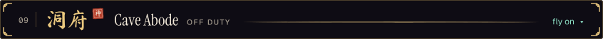</picture></a></p>

<pre><b>洞府 cave abode · the Sect Leader, off duty</b>
- won his first hackathon at 17
- speaks Mandarin and English; builds agents in both
- plays drums and piano when the laptop is closed
- still hunting the best bowl of noodles in San Francisco
- expects everyone to get a personal Jarvis. building toward it</pre>

<a id="summit"></a>
<p><a href="#top"><picture><source media="(max-width: 600px)" srcset="assets/banners/10-summit-phone.svg"><source media="(prefers-color-scheme: light)" srcset="assets/banners/10-summit-light.svg">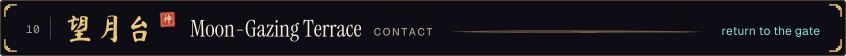</picture></a></p>

<pre><b>弟子名册 the disciple register · newest four</b><!-- PASSWD:START -->
no.  997  sleep      never initiated. optional dependency
no.  998  steward    keeps the mission hall. not a person
no.  999  bill       教主, Sect Leader. here since 2021-09-21
no. 1000  <a href="https://github.com/prakhxr0">prakhxr0</a>   外门 outer disciple. initiated 2024-06-14
the next number, 1001, is unclaimed. <a href="https://github.com/IdkwhatImD0ing/IdkwhatImD0ing">star this repo</a> to be initiated.
<!-- PASSWD:END --></pre>

<p align="center">The sect flies in full at <a href="https://art3m1s.me">art3m1s.me</a>, where a senior disciple (a voice agent) shows you around. Pigeons land at <a href="mailto:billzhangsc@gmail.com">billzhangsc@gmail.com</a>.</p>

```text
# the talisman also works in a terminal. on windows, use curl.exe.
curl -sL https://raw.githubusercontent.com/IdkwhatImD0ing/IdkwhatImD0ing/main/bill.ansi
```

<pre><b>the moon is up. the gate closes behind you.</b><!-- BOOT_ONELINER:START -->
the sect has gone 0 days without a spontaneous rewrite
<!-- BOOT_ONELINER:END --><!-- BUILD_PLATE:START -->
sealed by the steward · run 55 · from bda3bed · the human contributes
<!-- BUILD_PLATE:END -->
<a href="#top">return to the gate</a> · <a href="https://art3m1s.me">art3m1s.me</a> · petition the kitchen hall · <a href="https://github.com/IdkwhatImD0ing/IdkwhatImD0ing">source</a></pre>

<p align="center"><picture><source media="(max-width: 600px)" srcset="https://raw.githubusercontent.com/IdkwhatImD0ing/IdkwhatImD0ing/04bff9e53ca0134fdf165f20cea9939bfda1b205/assets/seal/emblem.svg"><source media="(prefers-color-scheme: light)" srcset="https://raw.githubusercontent.com/IdkwhatImD0ing/IdkwhatImD0ing/04bff9e53ca0134fdf165f20cea9939bfda1b205/assets/seal/emblem-light.svg"></picture></p>
